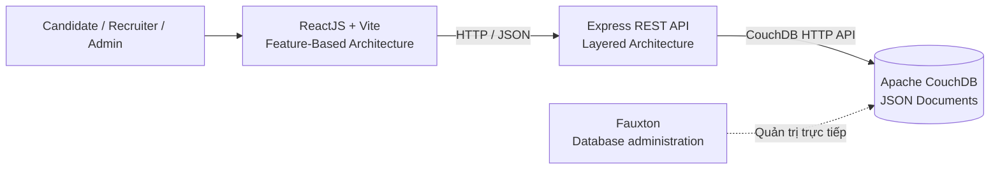
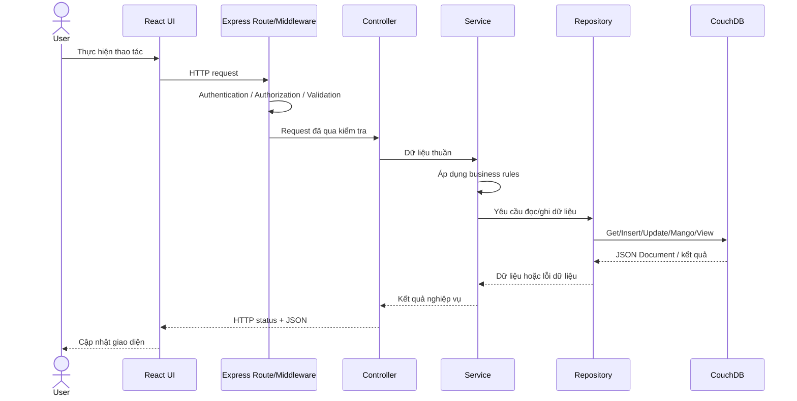
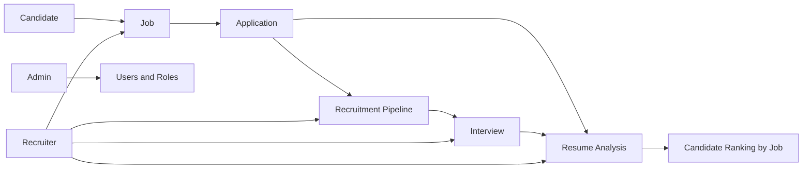

# Kiến trúc và quy tắc phát triển RecruiHub NoSQL

Tài liệu này là chuẩn kiến trúc bắt buộc cho developer và AI Coding Agent làm việc với RecruiHub NoSQL. Nội dung phân biệt rõ **source hiện tại** với **kiến trúc mục tiêu**; một thư mục đã tồn tại không có nghĩa chức năng tương ứng đã được triển khai.

## 1. Architectural Overview

RecruiHub sử dụng kiến trúc ba tầng:

1. ReactJS Frontend hiển thị UI và gọi REST API.
2. Express Backend kiểm soát HTTP contract, Authentication, Authorization, Validation, business rules và truy cập dữ liệu.
3. Apache CouchDB lưu JSON Document và cung cấp Mango Query/MapReduce View cho Backend.

Backend tổ chức theo **Layered Architecture** để tách HTTP, nghiệp vụ và Data Access. Frontend tổ chức theo **Feature-Based Architecture** để code của từng miền nghiệp vụ nằm gần nhau. Cách tổ chức này đủ rõ để ba thành viên phát triển song song mà không tạo quá nhiều tầng hoặc abstraction không cần thiết cho MVP.



Fauxton không nằm trong luồng xử lý nghiệp vụ. Frontend tuyệt đối không dùng CouchDB admin credentials và không truy cập CouchDB trực tiếp.

### Luồng request/response mục tiêu



### Trạng thái hiện tại và mục tiêu

| Phần | Source hiện tại | Kiến trúc mục tiêu |
|---|---|---|
| Backend | `app.js`, `server.js`, route/controller health | Đầy đủ Route → Controller → Service → Repository |
| Frontend | HomePage, Router, Axios client, health check | Các module theo `features/` và shared UI rõ ràng |
| Database | Docker CouchDB đang chạy; chưa có artifact nghiệp vụ trong repository | `recruitment_db`, document model, index và view cần thiết |
| Security | Chỉ có cấu hình CORS cơ bản | Authentication, role-based Authorization, validation và error handling |
| Analysis | Chưa triển khai | Rule-Based Matching và ranking theo công thức cố định |

## 2. Backend Architecture

### Cấu trúc mục tiêu

```text
backend/src/
├── config/
├── routes/
├── controllers/
├── services/
├── repositories/
├── schemas/
├── middleware/
├── utils/
├── constants/
├── app.js
└── server.js
```

Các thư mục trên đã tồn tại; hiện chỉ `routes/` và `controllers/` có module health. Chỉ tạo file con khi chức năng thực sự được triển khai.

### Trách nhiệm từng thành phần

#### `config/`

Chứa cấu hình ứng dụng, đọc/chuẩn hóa biến môi trường và cấu hình kết nối dịch vụ ngoài, ví dụ CouchDB client. Không chứa business logic.

#### `routes/`

Khai báo HTTP method, endpoint và chuỗi middleware/controller, ví dụ `GET /api/jobs`. Route không truy cập CouchDB trực tiếp và không xử lý nghiệp vụ.

#### `controllers/`

Nhận `params`, `query`, `body` từ Express Request; gọi Service; ánh xạ kết quả thành HTTP status/response. Controller phải ngắn, không chứa Mango Query hoặc thuật toán nghiệp vụ phức tạp.

Health controller hiện tại trả trực tiếp trạng thái tiến trình vì không có business rule hoặc dữ liệu cần truy cập. Đây là ngoại lệ đơn giản, không phải mẫu để bỏ qua Service cho API nghiệp vụ.

#### `services/`

Chứa business rules, ví dụ:

- kiểm tra Job đang `OPEN` và chưa hết deadline;
- ngăn Duplicate Active Application;
- kiểm soát Recruitment Pipeline và Stage Transition;
- điều phối Interview;
- tính Resume Analysis và Candidate Ranking.

Service nhận/trả dữ liệu thuần, không phụ thuộc `req`, `res` và không tự tạo HTTP response.

#### `repositories/`

Là Data Access Layer duy nhất cho CouchDB, thực hiện get/insert/update/delete Document, Mango Query và query MapReduce View. Repository không quyết định Candidate có được apply hay Application có được chuyển stage.

Tên file dự kiến khi có implementation: `user.repository.js`, `candidate.repository.js`, `job.repository.js`, `application.repository.js`, `interview.repository.js`, `analysis.repository.js`. Không tạo trước file rỗng.

#### `schemas/`

Chứa validation cho HTTP input và/hoặc JSON Document. CouchDB không ép schema cứng nên Backend phải kiểm tra kiểu dữ liệu, trường bắt buộc, enum và ràng buộc trước khi lưu. Không dùng Mongoose Model cho CouchDB.

#### `middleware/`

Chứa xử lý xuyên suốt như Authentication, Authorization, validation middleware và centralized error handling. Không đặt business rule tuyển dụng trong middleware.

#### `utils/`

Chứa helper dùng chung không phụ thuộc nghiệp vụ, ví dụ chuẩn hóa chuỗi hoặc định dạng ngày. Logic chỉ dùng riêng cho analysis/jobs nên ở module tương ứng thay vì đẩy mọi thứ vào `utils/`.

#### `constants/`

Khai báo tập giá trị cố định như Role, Job Status, Application Stage và Recommendation Level. Không lặp literal trạng thái ở nhiều module.

#### `app.js`

Khởi tạo Express app, global middleware và đăng ký routes. Source hiện tại cấu hình CORS, JSON middleware, `GET /` và `/api/health`.

#### `server.js`

Nạp biến môi trường và khởi động HTTP server. Source hiện tại dùng `PORT`, mặc định `5000`.

### Quy tắc phụ thuộc

```text
Route → Controller → Service → Repository → CouchDB
```

- Route có thể gọi Middleware và Controller.
- Controller chỉ điều phối HTTP và gọi Service.
- Service có thể gọi một hoặc nhiều Repository.
- Repository chỉ xử lý persistence/data mapping.
- Không có phụ thuộc ngược: Repository không gọi Service/Controller; Service không trả Express Response; Frontend không import code Backend.

## 3. API Conventions

API dùng REST và prefix hiện tại là `/api`. Không tự đổi sang `/api/v1` nếu chưa thống nhất cập nhật Backend, Frontend và API contract.

| Method | Ý nghĩa |
|---|---|
| `GET` | Đọc tài nguyên, không thay đổi trạng thái |
| `POST` | Tạo tài nguyên hoặc thực hiện action phù hợp |
| `PATCH` | Cập nhật một phần tài nguyên |
| `PUT` | Thay thế toàn bộ tài nguyên khi thực sự phù hợp |
| `DELETE` | Xóa tài nguyên khi business rule và quyền cho phép |

Endpoint đã triển khai và không được tự ý xóa/đổi:

```http
GET /api/health
```

Response hiện tại:

```json
{
  "success": true,
  "message": "RecruiHub Backend is running"
}
```

### Chuẩn response mục tiêu

Các định dạng sau là **đề xuất cho API nghiệp vụ tương lai**, chưa phải contract đã áp dụng toàn repository.

Success:

```json
{
  "success": true,
  "data": {},
  "message": "Optional human-readable message"
}
```

Error:

```json
{
  "success": false,
  "error": {
    "code": "VALIDATION_ERROR",
    "message": "Dữ liệu không hợp lệ",
    "details": []
  }
}
```

Quy tắc:

- Dùng status phù hợp: `200`, `201`, `204`, `400`, `401`, `403`, `404`, `409`, `422`, `500`.
- Validation input trước khi gọi business operation hoặc lưu dữ liệu.
- Authentication xác định danh tính; Authorization kiểm tra quyền và ownership.
- Không trả stack trace, credentials, CouchDB internals hoặc thông tin nhạy cảm cho client.
- Centralized error middleware nên chuyển lỗi domain/data thành response nhất quán.
- Không nhận Mango selector tùy ý từ client cho API nghiệp vụ.

## 4. Frontend Architecture

### Cấu trúc mục tiêu

```text
frontend/src/
├── api/
├── components/
│   ├── common/
│   └── layout/
├── features/
│   ├── auth/
│   ├── candidates/
│   ├── jobs/
│   ├── applications/
│   ├── interviews/
│   ├── analysis/
│   └── admin/
├── pages/
├── routes/
├── hooks/
├── contexts/
├── utils/
├── constants/
├── assets/
├── App.jsx
└── main.jsx
```

Các thư mục mục tiêu đã tồn tại nhưng phần lớn đang trống.

### Trách nhiệm từng thành phần

- `api/`: Axios instance và cấu hình HTTP dùng chung. `axiosClient.js` hiện lấy base URL từ `VITE_API_BASE_URL`.
- `components/common/`: UI dùng lại giữa nhiều feature như Button, Modal, Input, Table, Loading.
- `components/layout/`: Header, Sidebar, Navigation, Footer và MainLayout.
- `features/`: mỗi miền nghiệp vụ là một module tương đối độc lập. Ví dụ `features/jobs/` chỉ tạo `components/`, `pages/`, `hooks/`, `api/`, `utils/` khi thực sự có code.
- `pages/`: trang tổng hợp hoặc không thuộc riêng một feature, như HomePage. Page riêng của Jobs phải ở `features/jobs/pages/`.
- `routes/`: React Router, route definitions và protected routes.
- `hooks/`: Custom Hooks thực sự tái sử dụng giữa nhiều module.
- `contexts/`: global/shared state như Authentication Context; không dùng Context cho state cục bộ đơn giản.
- `utils/`: helper dùng chung không gắn với một feature.
- `constants/`: constants phía Frontend; giá trị domain phải nhất quán với Backend/API contract.
- `App.jsx`: component gốc, gắn Router và provider toàn cục khi cần.
- `main.jsx`: entry point khởi tạo React app.

## 5. Frontend Coding Rules

- Không gọi Axios rải rác trong UI component. API nghiệp vụ đặt tại `features/<feature>/api/` và dùng chung `src/api/axiosClient.js`.
- `HomePage.jsx` hiện gọi Axios trực tiếp chỉ để kiểm tra bootstrap integration; khi mở rộng nên chuyển request theo quy tắc feature/API module.
- Component tập trung render và user interaction; Hook điều phối state/side effect khi phù hợp.
- Không nhúng toàn bộ business logic vào JSX.
- Không đặt component chuyên biệt của Jobs trong `components/common/`.
- Không đặt Candidate page trong feature Recruiter/Admin.
- Tái sử dụng component/hook hiện có trước khi tạo bản trùng trách nhiệm.
- Không hardcode Backend URL; dùng `VITE_API_BASE_URL` qua Axios client.
- Không lưu Backend secrets hoặc CouchDB credentials trong Frontend hay biến `VITE_*`.

## 6. Apache CouchDB Architecture

Database nghiệp vụ mục tiêu là `recruitment_db`. Việc database này đã được tạo hoặc đã có dữ liệu **chưa được xác minh**; đây là thiết kế mục tiêu.

### Document types và quy ước `_id`

| `type` | Mẫu `_id` | Vai trò |
|---|---|---|
| `user` | `user:<id>` | Danh tính, role, trạng thái tài khoản |
| `candidate` | `candidate:<id>` | Hồ sơ ứng viên có cấu trúc |
| `recruiter` | `recruiter:<id>` | Hồ sơ recruiter/phạm vi quản lý |
| `company` | `company:<id>` | Doanh nghiệp |
| `department` | `department:<id>` | Phòng ban |
| `job` | `job:<id>` | Vị trí tuyển dụng và requirements |
| `application` | `application:<id>` | Quan hệ ứng tuyển và pipeline state |
| `interview` | `interview:<id>` | Một vòng phỏng vấn của Application |
| `resume_analysis` | `analysis:<application_id>` | Kết quả phân tích cho Application |

- `_id`: định danh ổn định, duy nhất của Document.
- `_rev`: revision token phục vụ optimistic concurrency của CouchDB.
- `type`: discriminator để phân loại và xây query/index.

### Modeling rules

- **Embed** dữ liệu nhỏ có cùng vòng đời và thường được đọc cùng document.
- **Reference** bằng ID khi document có vòng đời độc lập, được cập nhật riêng hoặc có quan hệ một-nhiều lớn.
- Chỉ denormalize có kiểm soát; ghi rõ nguồn dữ liệu chuẩn và cách đồng bộ snapshot.
- Không thiết kế dựa trên JOIN như RDBMS. Service/Repository chịu trách nhiệm phối hợp nhiều lần đọc khi cần.
- Khi update/delete, gửi đúng `_rev`; xử lý `409 Conflict` bằng cách đọc revision mới, đánh giá business state rồi retry có giới hạn hoặc trả lỗi conflict. Không ghi đè mù.
- Tạo Mango Index khớp với selector/sort được dùng thật. Không tạo hàng loạt index dự đoán.
- Dùng MapReduce View cho truy vấn tổng hợp ổn định, thường xuyên và phù hợp với cơ chế index của CouchDB.
- Repository chứa Mango Query/View call; Controller và Frontend không chứa selector database.
- Schema validation vẫn bắt buộc ở Backend dù CouchDB lưu document linh hoạt.

## 7. Core Business Flow



Hệ thống chỉ có ba actor đã thống nhất: Candidate, Recruiter và Admin.

Business rules tối thiểu:

- Candidate chỉ đọc/sửa hồ sơ thuộc quyền sở hữu của mình.
- Recruiter chỉ thao tác Job, Application, Interview và Candidate data trong phạm vi được cấp quyền.
- Job phải hợp lệ trước khi publish.
- Khi apply phải kiểm tra Job status, deadline và Duplicate Active Application.
- Application chỉ chuyển stage theo Stage Transition Rules; không nhận stage tùy ý từ client.
- Một Application có thể có nhiều Interview round.
- Resume Analysis sử dụng Candidate Profile có cấu trúc và requirements của Job.
- Candidate Ranking luôn theo từng Job, không tạo một thứ hạng chung thiếu ngữ cảnh.

Các rule này là yêu cầu mục tiêu, chưa được triển khai trong source hiện tại.

## 8. Resume Analysis Architecture

Resume Analysis dùng **Rule-Based Matching**, không bắt buộc AI, LLM, OCR hay Machine Learning.

Quy trình mục tiêu:

1. Đọc Candidate Profile qua Candidate Repository.
2. Đọc Job Requirements qua Job Repository.
3. Normalize Skills.
4. Xác định Matched Skills và Missing Skills.
5. Tính `skill_score`.
6. Tính `experience_score`.
7. Tính `education_score`.
8. Tính `project_score`.
9. Tính Weighted Match Score.
10. Phân loại Recommendation.
11. Lưu `resume_analysis` qua Analysis Repository.
12. Ranking các Application theo từng Job.

Công thức bắt buộc, không tự ý thay trọng số:

```text
MatchScore = 0.50 × SkillScore
           + 0.25 × ExperienceScore
           + 0.10 × EducationScore
           + 0.15 × ProjectScore
```

| Recommendation | Điều kiện `total_score` |
|---|---|
| `HIGH` | `>= 80` |
| `MEDIUM` | `>= 60` và `< 80` |
| `LOW` | `< 60` |

Thứ tự ranking:

1. `total_score` giảm dần.
2. Nếu bằng nhau, `skill_score` giảm dần.
3. Nếu vẫn bằng nhau, `applied_at` theo thứ tự đã thống nhất của nghiệp vụ; mặc định ưu tiên Application nộp sớm hơn.

Thuật toán và điều phối đặt trong Service; truy xuất/lưu kết quả đặt trong Repository. Controller chỉ nhận request, gọi Service và trả response. Source hiện tại chưa triển khai chức năng này.

## 9. Development Workflow & Commands

### Docker - chạy tại repository root

```powershell
docker compose up -d
docker compose ps
docker compose logs -f couchdb
docker compose down
```

`docker compose down` là lệnh dừng thông thường và giữ named volume. `docker compose down -v` có thể xóa `couchdb_data` cùng dữ liệu, vì vậy không dùng trong quy trình dừng thông thường.

### Backend - chạy trong `backend/`

```powershell
npm install
npm run dev
npm start
```

`npm test` hiện là placeholder chủ động trả lỗi, không phải test suite hợp lệ.

### Frontend - chạy trong `frontend/`

```powershell
npm install
npm run dev
npm run lint
npm run build
npm run preview
```

Chỉ dùng `preview` sau khi build để xem production build local.

### Git - chạy tại repository root

```powershell
git status
git branch
git add <path>
git commit -m "<type>: <short description>"
git pull
git push
```

Kiểm tra diff và branch trước khi commit/push. Tài liệu này không xác nhận repository đã có remote; hiện repository cũng chưa có commit.

## 10. Security Rules

Các quy tắc sau bắt buộc; những cơ chế chưa có source là yêu cầu cho implementation tương lai:

- Không commit `.env`, password, token, CouchDB credentials hoặc backup nhạy cảm.
- Không hardcode secrets trong source, tài liệu hoặc sample data.
- Frontend không truy cập CouchDB bằng quyền admin và không lưu database credentials.
- Password người dùng phải hash bằng cơ chế phù hợp; không lưu plaintext.
- Authentication không thay thế Authorization: mọi resource cần kiểm tra role, scope và ownership.
- Không cho mọi role thao tác mọi tài nguyên.
- Không nhận Mango selector/query tùy ý từ client cho API nghiệp vụ.
- Validate và normalize input trước khi lưu; giới hạn trường client được phép cập nhật.
- Không tiết lộ stack trace, query internals hoặc sensitive data trong error response/log.
- Kiểm soát quyền xem hồ sơ ứng viên và dữ liệu phỏng vấn.
- CORS phải giới hạn origin phù hợp; source hiện tại dùng `FRONTEND_URL` hoặc local default.
- Xử lý `_rev`/`409 Conflict`; không bỏ qua concurrency control.
- Không coi Health API thành bằng chứng database đã kết nối.

## 11. Git & Collaboration Rules

- `main` là nhánh chính.
- Dùng feature branch khi phát triển độc lập, ví dụ `feature/candidate-profile`, `feature/job-management`, `feature/resume-analysis`, `fix/...`, `docs/...`.
- Tên branch trên là quy ước đề xuất, không phải danh sách branch đang tồn tại.
- Commit nhỏ, có ý nghĩa; không commit `node_modules`, `.env`, credentials, backup nhạy cảm hoặc generated build.
- Không force push nếu chưa có thống nhất rõ ràng.
- Không sửa module của thành viên khác ngoài phạm vi cần thiết.
- Review thay đổi ảnh hưởng API contract, document model, constants hoặc kiến trúc dùng chung trước khi merge.
- Cập nhật `README.md`/`ARCHITECTURE.md` khi thay đổi setup, cấu trúc hoặc quy tắc quan trọng.

## 12. Where Should New Code Go?

| Công việc | Vị trí đúng |
|---|---|
| Thêm API endpoint | `backend/src/routes/` |
| Nhận/trả HTTP Request/Response | `backend/src/controllers/` |
| Kiểm tra Job có thể Apply | `backend/src/services/` |
| Kiểm tra Stage Transition | `backend/src/services/` |
| Tính Match Score/Ranking | `backend/src/services/` |
| Mango Query đọc Job | `backend/src/repositories/` |
| Lưu `resume_analysis` | `backend/src/repositories/` |
| Cấu hình CouchDB | `backend/src/config/` |
| Validation Job Document/input | `backend/src/schemas/` |
| Authentication/kiểm tra role | `backend/src/middleware/` |
| Khai báo Job Status/Application Stage | `backend/src/constants/` |
| Helper thuần, dùng chung | `backend/src/utils/` |
| Component Job Card | `frontend/src/features/jobs/components/` |
| Job List Page | `frontend/src/features/jobs/pages/` |
| API của Jobs | `frontend/src/features/jobs/api/` |
| Axios instance | `frontend/src/api/` |
| Shared Button/Modal | `frontend/src/components/common/` |
| App Layout/Header/Sidebar | `frontend/src/components/layout/` |
| React Router/protected route | `frontend/src/routes/` |
| Shared Context | `frontend/src/contexts/` |
| Hook dùng chung nhiều feature | `frontend/src/hooks/` |
| Page tổng hợp không thuộc feature | `frontend/src/pages/` |

### Anti-pattern cần tránh

**Sai:**

- Controller viết Mango Query hoặc gọi CouchDB trực tiếp cho nghiệp vụ phức tạp.
- Repository kiểm tra quyền tuyển dụng hoặc trả Express Response.
- Service phụ thuộc `req`/`res`.
- React component chứa CouchDB credentials hoặc gọi CouchDB.
- Viết toàn bộ Match Score trong Controller.
- Đặt mọi Page/component/side effect trong `App.jsx`.
- Hardcode Backend URL ở nhiều file.
- Tạo nhiều module cùng một trách nhiệm hoặc tạo sẵn file/thư mục rỗng không có nhu cầu.

**Đúng:**

- Route → Controller → Service → Repository với trách nhiệm rõ ràng.
- API client tập trung và feature API module gọi client này.
- Business rules ở Service; database query ở Repository.
- Shared UI ở `components/common/`; business-specific UI ở feature tương ứng.
- Tái sử dụng module hiện có và chỉ thêm abstraction khi có nhu cầu thực tế.

### Quy trình thêm một feature

1. Xác định actor, use case, authorization và API contract.
2. Xác định Document hiện có hay cần document type mới; thống nhất `_id`, `type`, index và ownership.
3. Thêm Backend theo chiều Repository → Service → Controller → Route, kèm validation/middleware cần thiết.
4. Thêm Frontend API module, Hook/state và UI trong đúng feature.
5. Dùng constants chung thay cho literal lặp lại.
6. Chạy lint/build/test thực sự tồn tại và kiểm tra endpoint liên quan.
7. Cập nhật tài liệu nếu cấu trúc, config, API contract hoặc architecture rule thay đổi.

## 13. Rules for Future AI Coding Agents

Mọi AI Coding Agent làm việc với repository phải:

1. Đọc `README.md` và `ARCHITECTURE.md` trước khi lập trình.
2. Kiểm tra source và Git state thực tế; không suy đoán file, endpoint hoặc trạng thái triển khai.
3. Xác định đúng feature và layer chịu trách nhiệm trước khi sửa.
4. Ưu tiên mở rộng module hiện có, không tạo layer/thư mục trùng chức năng.
5. Giữ React + Vite, Express, JavaScript và CouchDB; không tự đổi technology stack.
6. Không thêm Mongoose, Prisma, Sequelize, MongoDB, SQL database, Next.js, NestJS hoặc TypeScript nếu chưa được phê duyệt.
7. Không thay đổi API contract, prefix `/api` hoặc `GET /api/health` thiếu lý do và kế hoạch tương thích.
8. Không phá luồng Authentication/Authorization hoặc bỏ kiểm tra ownership/scope.
9. Không thay công thức, trọng số, ngưỡng Recommendation hay thứ tự Ranking của Resume Analysis.
10. Không viết database query hoặc credentials ở Frontend.
11. Không đặt business logic phức tạp/Mango Query trong Controller.
12. Không sửa file ngoài phạm vi yêu cầu nếu không cần thiết; bảo toàn thay đổi chưa commit của người dùng.
13. Không ghi đè, xóa source/dữ liệu đang hoạt động hoặc thực hiện thao tác database phá hủy.
14. Không tạo dữ liệu, test result hoặc bằng chứng giả.
15. Không commit, push, force push hoặc thay đổi remote nếu chưa được yêu cầu.
16. Chỉ thêm dependency khi cần; nêu mục đích và kiểm tra tương thích trước.
17. Sau khi sửa code, chạy đúng script repository hỗ trợ; không báo test thành công nếu script chỉ là placeholder.
18. Báo cáo rõ file đã sửa, lý do, kiểm tra đã chạy và giới hạn còn lại.
19. Nếu yêu cầu mới xung đột kiến trúc, giải thích xung đột trước khi triển khai.
20. Ưu tiên giải pháp đơn giản, dễ hiểu và dễ bảo trì cho MVP của nhóm 3 sinh viên.

## Ghi nhận chênh lệch hiện tại

- Cấu trúc thư mục Backend/Frontend mục tiêu đã được tạo, nhưng phần lớn thư mục đang trống; không được xem đây là bằng chứng chức năng đã hoàn thành.
- Backend chưa có CouchDB client/config/repository nên health endpoint chưa kiểm tra database.
- `HomePage.jsx` gọi Axios trực tiếp để kiểm tra kết nối bootstrap; code feature tương lai phải dùng feature API module.
- Chưa có `backend/.env.example` dù source hỗ trợ `PORT` và `FRONTEND_URL`.
- `database/` và `docs/` đang trống; chưa có dataset, Mango Index, Design Document hoặc tài liệu bổ sung.
- Backend test script chỉ là placeholder; Frontend chưa có automated test script.
- Repository chưa có commit, remote hoặc GitHub workflow được xác minh.

Các chênh lệch này cần được xử lý dần khi triển khai feature; không tự tạo hàng loạt placeholder chỉ để làm cây thư mục trông hoàn chỉnh.
