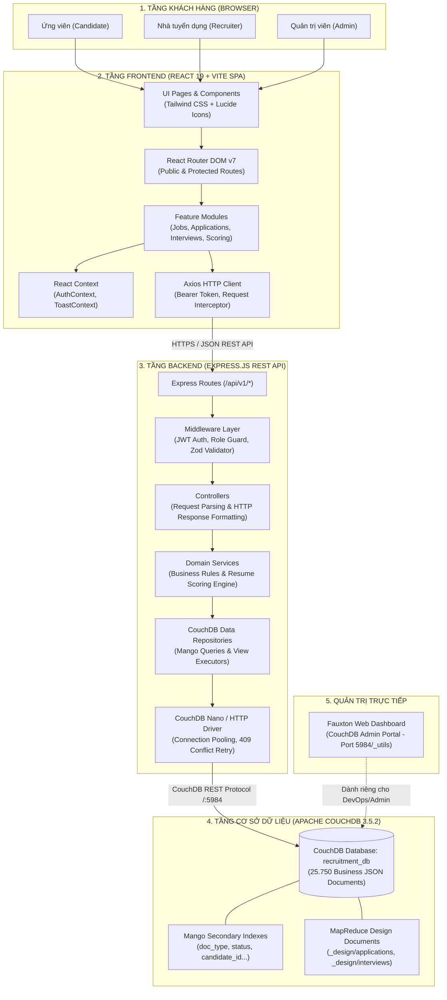
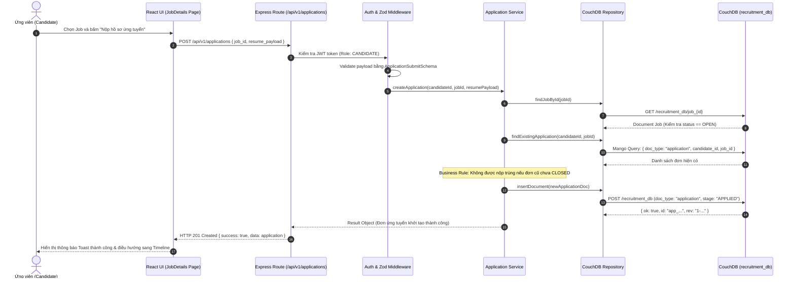
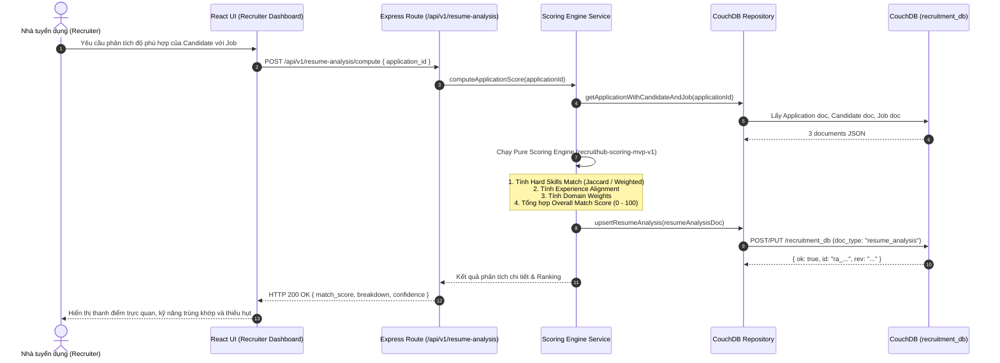

# Kiến trúc hệ thống RecruiHub NoSQL

Tài liệu này mô tả chi tiết kiến trúc kỹ thuật của hệ thống **RecruiHub NoSQL**, ranh giới trách nhiệm giữa Frontend, Backend và Database, luồng dữ liệu nghiệp vụ, cấu trúc thư mục, quy tắc bảo mật và định hướng mở rộng hệ thống theo mô hình **Full-stack Vertical Slice**.

> **Trạng thái tài liệu:**
> - **Đã hoàn thành:** Hạ tầng NoSQL Apache CouchDB, cơ sở dữ liệu `recruitment_db` với 25.750 documents thuộc 9 loại tài liệu, bộ Zod schemas, Resume-Job scoring engine (`recruithub-scoring-mvp-v1`) và 246 automated tests PASS.
> - **Đang triển khai:** Tầng REST API trên Express.js 5 và giao diện React 19 SPA dựa trên template tham khảo `docs/Job-Application-Portal-Frontend/`.

---

## 1. Tổng quan kiến trúc hệ thống

RecruiHub NoSQL được xây dựng theo kiến trúc ba tầng phân lập (Three-Tier Architecture):

1. **Frontend (React SPA)**: Giao diện web đơn trang tương tác cao, tổ chức theo **Feature-Based Architecture**, quản lý trạng thái tập trung và kết nối Backend thông qua REST API.
2. **Backend (Express REST API)**: Ứng dụng Node.js tổ chức theo **Layered Architecture**, đóng vai trò Gateway duy nhất kiểm soát Authentication, Authorization, Validation, Business Rules và điều phối dữ liệu với CouchDB.
3. **Database (Apache CouchDB)**: Hệ quản trị cơ sở dữ liệu NoSQL hướng tài liệu (Document-Oriented Database), lưu trữ toàn bộ dữ liệu dưới dạng JSON Documents trong một database duy nhất `recruitment_db`, cung cấp khả năng truy vấn bằng Mango Query và MapReduce Views.



### Ranh giới trách nhiệm và bảo mật nghiêm ngặt
- **Không truy cập trực tiếp CouchDB từ Frontend**: Trình duyệt tuyệt đối không kết nối trực tiếp đến CouchDB port 5984 và không bao giờ lưu trữ CouchDB admin credentials. Mọi thao tác đọc/ghi phải đi qua Express API.
- **Fauxton chỉ dành cho quản trị**: Fauxton GUI (`/_utils`) phục vụ cho việc kiểm tra chỉ mục, giám sát dung lượng database và bảo trì dữ liệu của developer, không nằm trong luồng nghiệp vụ của người dùng cuối.

---

## 2. Luồng xử lý nghiệp vụ mục tiêu (Sequence Diagrams)

### 2.1. Luồng nộp hồ sơ ứng tuyển (Job Application Submission)



### 2.2. Luồng phân tích và chấm điểm hồ sơ (Resume Matching & Scoring)



---

## 3. Kiến trúc Backend (Express REST API)

Backend được tổ chức theo mô hình phân lớp rõ ràng (Layered Architecture):

```text
backend/src/
├── config/                  # Biến môi trường, kết nối CouchDB, cấu hình JWT
│   ├── env.config.js
│   └── couchdb.config.js
├── routes/                  # Định nghĩa endpoints REST API phân theo module
│   ├── auth.routes.js       # /api/v1/auth
│   ├── candidate.routes.js  # /api/v1/candidates
│   ├── job.routes.js        # /api/v1/jobs
│   ├── application.routes.js# /api/v1/applications
│   ├── interview.routes.js  # /api/v1/interviews
│   ├── scoring.routes.js    # /api/v1/resume-analysis
│   └── admin.routes.js      # /api/v1/admin
├── middleware/              # Kiểm soát bảo mật, phân quyền, tiền xử lý
│   ├── auth.middleware.js   # Verify JWT Token & giải mã user context
│   ├── role.middleware.js   # Phân quyền RBAC (ADMIN, RECRUITER, CANDIDATE)
│   ├── validate.middleware.js# Middleware kiểm tra Zod Schema tự động
│   └── error.middleware.js  # Xử lý ngoại lệ tập trung (Centralized Error Handler)
├── controllers/             # Điều phối request / response, không chứa business logic
│   ├── auth.controller.js
│   ├── job.controller.js
│   ├── application.controller.js
│   ├── interview.controller.js
│   └── scoring.controller.js
├── services/                # Chứa toàn bộ nghiệp vụ và thuật toán thuần túy
│   ├── auth.service.js
│   ├── job.service.js
│   ├── application.service.js
│   ├── interview.service.js
│   └── scoring/             # Scoring engine đã hoàn thành ở DATA-03.4A
│       ├── resume-scoring.service.js
│       ├── skill-matcher.js
│       ├── ranking-calculator.js
│       └── scoring-fingerprint.js
├── models/ / repositories/  # Tương tác với CouchDB qua HTTP Client / Nano
│   ├── base.repository.js   # Các phương thức CRUD cơ sở, handle _rev conflict
│   ├── job.repository.js    # Mango Query lọc Job theo filter/pagination
│   ├── application.repository.js
│   └── interview.repository.js
├── schemas/                 # Zod Schemas chính thức (Contract nguồn sự thật)
│   ├── common.schema.js
│   ├── user.schema.js
│   ├── candidate.schema.js
│   ├── recruiter.schema.js
│   ├── job.schema.js
│   ├── application.schema.js
│   ├── interview.schema.js
│   ├── resume_analysis.schema.js
│   └── log.schema.js
└── utils/                   # Hàm tiện ích dùng chung
    ├── logger.js            # Logging chuẩn hóa, che giấu credentials
    └── response-helper.js   # Định dạng chuẩn: { success, data, error, message }
```

### Nguyên tắc bắt buộc đối với Backend:
1. **Controller mỏng (Thin Controller)**: Controller chỉ nhận dữ liệu từ `req`, gọi Service tương ứng, và trả về status HTTP cùng JSON chuẩn qua `response-helper.js`.
2. **Service giàu nghiệp vụ (Rich Service)**: Toàn bộ quy tắc trong `docs/recruitment-business-rules.md` (như kiểm tra trạng thái Job `OPEN`, 7 stages của Application, chuyển đổi stage hợp lệ) phải được thực thi trong Service.
3. **Quản lý xung đột CouchDB (`HTTP 409 Conflict`)**: Khi cập nhật document, Repository phải luôn kèm theo `_rev` mới nhất. Nếu gặp xung đột do ghi đồng thời, áp dụng cơ chế đọc lại `_rev` và retry tối đa 3 lần với exponential backoff.

---

## 4. Kiến trúc Frontend (React 19 + Vite SPA)

Frontend tổ chức theo **Feature-Based Architecture**, kết hợp UI/UX hiện đại từ template tham khảo `docs/Job-Application-Portal-Frontend/`:

```text
frontend/src/
├── api/                     # Cấu hình kết nối Backend
│   ├── client.js            # Axios instance chung (baseURL, interceptors)
│   └── endpoints.js         # Khai báo đường dẫn API tập trung
├── assets/                  # Hình ảnh, biểu tượng tĩnh
├── components/              # UI Components dùng chung toàn hệ thống
│   ├── common/              # Button, Input, Select, Modal, Spinner, Badge
│   ├── layout/              # Navbar, Sidebar, Footer, RoleContainer
│   └── feedback/            # ToastNotification, ConfirmationDialog, ErrorBoundary
├── context/                 # State quản lý toàn cục
│   ├── AuthContext.jsx      # Quản lý phiên đăng nhập, current user, role
│   └── ToastContext.jsx     # Quản lý hàng đợi thông báo
├── features/                # Các module chức năng đóng gói độc lập
│   ├── auth/                # Login, Register, ForgotPassword forms
│   ├── jobs/                # JobList, JobCard, JobDetail, JobFilter, CreateJobForm
│   ├── applications/        # ApplyModal, ApplicationCard, ApplicationTimeline (7 stages)
│   ├── interviews/          # InterviewScheduleModal, FeedbackForm, InterviewList
│   ├── scoring/             # MatchScoreBadge, ScoreBreakdownDrawer, CandidateRankTable
│   └── admin/               # UserTable, DocumentStatsCard, SystemLogViewer
├── hooks/                   # Custom React Hooks
│   ├── useAuth.js
│   ├── useJobs.js
│   └── useDebounce.js
├── mocks/                   # Mock data phục vụ phát triển UI độc lập
│   └── job-mocks.js
├── pages/                   # Màn hình ghép nối từ các Feature Components
│   ├── Landing.jsx          # Trang chủ công cộng
│   ├── Login.jsx
│   ├── Register.jsx
│   ├── JobsPage.jsx
│   ├── JobDetailPage.jsx
│   ├── candidate/           # Phân vùng Candidate
│   │   ├── CandidateDashboard.jsx
│   │   └── CandidateProfile.jsx
│   ├── recruiter/           # Phân vùng Recruiter
│   │   ├── RecruiterDashboard.jsx
│   │   ├── JobApplicantsPage.jsx
│   │   └── PostJobPage.jsx
│   └── admin/               # Phân vùng Admin
│       └── AdminDashboard.jsx
├── routes/                  # Cấu hình tuyến đường React Router
│   ├── AppRoutes.jsx        # Toàn bộ danh mục Route
│   └── ProtectedRoute.jsx   # Role-based Guard (bảo vệ trang theo quyền)
├── utils/                   # Định dạng ngày giờ (dayjs), tiền tệ, text helper
├── index.css                # Tailwind CSS direct imports & base theme tokens
└── main.jsx                 # Entry point khởi tạo React App
```

### Quy tắc phát triển Frontend:
1. **Template tham khảo `docs/Job-Application-Portal-Frontend/`**: Thư mục này chỉ dùng để đọc, tham khảo cách bố cục và sao chép chọn lọc sang `frontend/src/`. Tuyệt đối không import runtime hoặc chạy server từ bên trong thư mục `docs/`.
2. **Không gọi API trực tiếp trong Component**: Mọi request HTTP phải đi qua các hàm service nằm trong `features/*/services/` hoặc `api/`.
3. **Xử lý đầy đủ 4 trạng thái giao diện**: Mọi màn hình phải có đủ trạng thái:
   - *Loading*: Skeleton loading hoặc Spinner.
   - *Empty*: Thông báo khi không có dữ liệu (ví dụ: chưa có ứng viên nào ứng tuyển).
   - *Error*: Thông báo lỗi thân thiện, nút bấm thử lại (Retry).
   - *Success*: Hiển thị dữ liệu hoàn chỉnh.

---

## 5. Chiến lược dữ liệu CouchDB NoSQL

### 5.1. Phân loại 9 Document Types
Mỗi document trong `recruitment_db` đều chứa trường định danh bắt buộc: `doc_type`:

```json
{
  "_id": "app_001_cand_042",
  "_rev": "1-a1b2c3d4...",
  "doc_type": "application",
  "candidate_id": "cand_042",
  "job_id": "job_001",
  "current_stage": "INTERVIEWING",
  "stage_history": [
    { "stage": "APPLIED", "changed_at": "2026-03-01T08:00:00.000Z" },
    { "stage": "SCREENING", "changed_at": "2026-03-02T10:00:00.000Z" },
    { "stage": "INTERVIEWING", "changed_at": "2026-03-05T14:30:00.000Z" }
  ],
  "created_at": "2026-03-01T08:00:00.000Z",
  "updated_at": "2026-03-05T14:30:00.000Z"
}
```

### 5.2. Chiến lược đánh chỉ mục Mango Query (Secondary Indexing)
Để đảm bảo tốc độ truy vấn trên 25.750 documents, hệ thống thiết lập các chỉ mục Mango chuyên biệt:
- **`idx_jobs_status_date`**: Phục vụ tìm kiếm việc làm công cộng (`doc_type: "job"`, `status: "OPEN"`, `created_at`).
- **`idx_applications_job_stage`**: Phục vụ Recruiter xem ứng viên theo Job và Stage (`doc_type: "application"`, `job_id`, `current_stage`).
- **`idx_applications_candidate`**: Phục vụ Candidate xem lịch sử ứng tuyển của mình (`doc_type: "application"`, `candidate_id`).
- **`idx_interviews_application`**: Phục vụ theo dõi lịch phỏng vấn theo đơn nộp (`doc_type: "interview"`, `application_id`).
- **`idx_scoring_application`**: Phục vụ truy xuất điểm số Resume Analysis (`doc_type: "resume_analysis"`, `application_id`).

### 5.3. Chiến lược MapReduce Design Documents (Thống kê và Báo cáo)
Các tác vụ tổng hợp dữ liệu nặng (như đếm số lượng document theo từng loại, thống kê số ứng viên đỗ theo từng Job) được giao cho MapReduce Views của CouchDB xử lý trước:
- `_design/stats/_view/by_doc_type`: Sử dụng hàm map `emit(doc.doc_type, 1)` và reduce `_count` có sẵn của Erlang/CouchDB để cung cấp số liệu tức thì cho Admin Dashboard mà không cần quét toàn bộ bảng.

---

## 6. Tiêu chuẩn bảo mật và xử lý lỗi

### 6.1. Bảo mật và phân quyền (Security & RBAC)
- **Cơ chế xác thực**: JSON Web Token (JWT) được ký bởi backend secret, thời hạn phù hợp.
- **Phân quyền dựa trên vai trò (Role-Based Access Control)**:
  - `CANDIDATE`: Chỉ được xem/sửa hồ sơ cá nhân và các applications của chính mình.
  - `RECRUITER`: Được tạo/sửa jobs của mình, xem hồ sơ ứng viên nộp vào job đó, xem điểm Resume Match Score, tạo lịch Interview.
  - `ADMIN`: Có toàn quyền quản trị tài khoản, xem thống kê toàn hệ thống.
- **Kiểm tra quyền sở hữu (Ownership Verification)**: Backend bắt buộc đối chiếu ID trong token với ID người sở hữu tài nguyên trước khi cho phép cập nhật dữ liệu.

### 6.2. Định dạng phản hồi REST API chuẩn hóa
Toàn bộ API trả về cấu trúc thống nhất:

```json
// Phản hồi thành công
{
  "success": true,
  "data": { ... },
  "message": "Nộp hồ sơ ứng tuyển thành công"
}

// Phản hồi lỗi
{
  "success": false,
  "error": {
    "code": "VALIDATION_ERROR",
    "details": [
      { "field": "resume_payload.skills", "message": "Kỹ năng không được để trống" }
    ]
  },
  "message": "Dữ liệu gửi lên không hợp lệ"
}
```

---

## 7. Phân công phát triển theo mô hình Full-stack Vertical Slice

Dự án được phân chia thành các lát cắt dọc trọn vẹn (Vertical Slices) cho 3 thành viên:

| Thành viên | Lát cắt nghiệp vụ sở hữu | Tầng Backend | Tầng Frontend |
| :--- | :--- | :--- | :--- |
| **TV1** | Auth, Candidate Profile, Public Job Search, Admin Dashboard | `auth.*`, `candidate.*`, `admin.*` routes/services | `Landing`, `Login`, `Register`, `JobList`, `CandidateProfile`, `AdminDashboard` |
| **TV2** | Recruiter Job Management, Application Pipeline (7 stages) | `job.*`, `application.*` routes/services | `PostJobPage`, `JobDetails`, `ApplicationTimeline`, `JobApplicantsPage` |
| **TV3** | Interview Management, Resume Scoring & AI Ranking, System Logs | `interview.*`, `scoring.*`, `log.*` routes/services | `InterviewModal`, `MatchScoreBadge`, `ScoreBreakdownDrawer`, `CandidateRankTable` |

*Chi tiết phân công, kế hoạch nhánh Git và ma trận phụ thuộc: xem tại [docs/recruithub-team-work-assignment.md](file:///docs/recruithub-team-work-assignment.md).*
