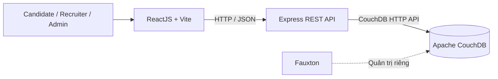

# RecruiHub NoSQL

## Giới thiệu

**Tên đề tài:** Xây dựng hệ thống quản lý tuyển dụng và phân tích hồ sơ ứng viên  
**English title:** Recruitment Management and Candidate Resume Analysis System using NoSQL  
**Nhóm thực hiện:** Nhóm 8 - 3 sinh viên  
**Học phần:** Dữ liệu NoSQL

RecruiHub NoSQL là đồ án web hỗ trợ quản lý quy trình tuyển dụng, hồ sơ ứng viên, các vòng phỏng vấn và đánh giá mức độ phù hợp của ứng viên với từng vị trí. Apache CouchDB là cơ sở dữ liệu chính, lưu dữ liệu nghiệp vụ dưới dạng JSON Document và phục vụ truy vấn qua Backend REST API.

Phạm vi dự án là một MVP phù hợp với nhóm 3 sinh viên, không hướng đến một hệ thống ATS thương mại hoàn chỉnh.

> **Trạng thái hiện tại:** repository mới hoàn thành phần khởi tạo Frontend, Backend, Docker CouchDB và kiểm tra kết nối Frontend - Backend. Các chức năng tuyển dụng bên dưới là **phạm vi nghiệp vụ dự kiến**, chưa phải tất cả đều đã được triển khai.

## Chức năng chính

### Candidate

- Đăng ký, đăng nhập.
- Quản lý hồ sơ ứng viên.
- Xem, tìm kiếm và xem chi tiết Job.
- Nộp Application và theo dõi trạng thái.
- Rút Application khi thỏa mãn điều kiện nghiệp vụ.

### Recruiter

- Quản lý Job và danh sách Application.
- Quản lý Recruitment Pipeline và Interview.
- Phân tích mức độ phù hợp của Candidate.
- Xếp hạng Candidate theo từng Job.
- Theo dõi Recruitment Dashboard ở phạm vi MVP.

### Admin

- Quản lý User và Role.
- Khóa hoặc mở khóa User.
- Xem tổng quan hệ thống ở phạm vi phù hợp với đồ án.

## Technology Stack

| Tầng / mục đích | Công nghệ |
|---|---|
| Frontend | ReactJS 19, Vite 8, JavaScript |
| Routing | React Router DOM 7 |
| HTTP Client | Axios 1 |
| Backend | Node.js, Express.js 5 |
| API | REST API |
| Database | Apache CouchDB 3.5.2.1 |
| Database GUI | Fauxton |
| Query mục tiêu | Mango Query, MapReduce View |
| Database deployment | Docker Compose |
| Version control | Git, GitHub khi cấu hình remote |
| Resume analysis mục tiêu | Rule-Based Matching và Weighted Match Score |

Các phiên bản package chính ở bảng trên được đối chiếu từ `package.json`; phiên bản chính xác đang khóa được lưu trong các file `package-lock.json`.

## Kiến trúc hệ thống



Frontend chỉ giao tiếp với Backend. Backend chịu trách nhiệm Authentication, Authorization, Validation, business rules và truy vấn dữ liệu. Frontend **không được** kết nối trực tiếp đến CouchDB bằng tài khoản quản trị. Fauxton chỉ là giao diện quản trị CouchDB, không thuộc luồng nghiệp vụ của ứng dụng.

Xem thiết kế chi tiết và các quy tắc bắt buộc tại [ARCHITECTURE.md](./ARCHITECTURE.md).

## Cấu trúc dự án

Cây dưới đây phản ánh repository tại thời điểm tài liệu được cập nhật. Các thư mục kiến trúc rỗng đã được tạo sẵn nhưng chưa đồng nghĩa với việc module nghiệp vụ đã hoàn thành.

```text
recruithub-nosql/
├── backend/
│   ├── src/
│   │   ├── config/           # Mục tiêu: cấu hình và kết nối dịch vụ
│   │   ├── constants/        # Mục tiêu: hằng số dùng chung
│   │   ├── controllers/
│   │   │   └── health.controller.js
│   │   ├── middleware/       # Mục tiêu: middleware dùng chung
│   │   ├── repositories/     # Mục tiêu: Data Access Layer cho CouchDB
│   │   ├── routes/
│   │   │   └── health.routes.js
│   │   ├── schemas/          # Mục tiêu: validation schema
│   │   ├── services/         # Mục tiêu: business logic
│   │   ├── utils/            # Mục tiêu: helper dùng chung
│   │   ├── app.js
│   │   └── server.js
│   └── package.json
├── database/                 # Hiện chưa có dataset/index/design document
├── docs/                     # Hiện chưa có tài liệu bổ sung
├── frontend/
│   ├── public/
│   ├── src/
│   │   ├── api/axiosClient.js
│   │   ├── assets/
│   │   ├── components/common/
│   │   ├── components/layout/
│   │   ├── constants/
│   │   ├── contexts/
│   │   ├── features/         # Các thư mục feature mục tiêu đang trống
│   │   ├── hooks/
│   │   ├── pages/HomePage.jsx
│   │   ├── routes/AppRouter.jsx
│   │   ├── utils/
│   │   ├── App.jsx
│   │   └── main.jsx
│   ├── .env.example
│   └── package.json
├── .env.example              # Biến cho Docker Compose/CouchDB
├── .gitignore
├── ARCHITECTURE.md
├── docker-compose.yml
└── README.md
```

- `backend/`: Express REST API và nơi triển khai business logic, validation, authorization và truy cập CouchDB.
- `frontend/`: giao diện React, routing và Axios client dùng chung.
- `database/`: vị trí dự kiến cho dữ liệu mẫu, Mango Index và Design Document; hiện đang trống.
- `docs/`: vị trí tài liệu bổ sung; hiện đang trống.
- `docker-compose.yml`: chạy một service CouchDB với named volume `couchdb_data`.
- `.env.example`: mẫu biến môi trường cho CouchDB, không chứa mật khẩu sử dụng thực tế.

## Yêu cầu trước khi cài đặt

- Node.js và npm tương thích với dependency hiện tại.
- Git.
- Docker Desktop với Docker Compose.
- Windows PowerShell cho các lệnh minh họa dưới đây.

Môi trường thiết lập ban đầu đã sử dụng Node.js `v24.20.0`, npm `11.19.0`, Git `2.55.0.windows.5`, Docker `29.7.2` và Docker Compose `v5.5.0`. Đây là thông tin tham khảo, không phải yêu cầu khóa cứng nếu phiên bản tương thích khác có thể cài và chạy dependency.

## Cài đặt và chạy local

### 1. Clone repository

Repository hiện chưa có Git remote để xác minh URL. Thay placeholder bằng URL thật sau khi repository được tạo trên GitHub:

```powershell
git clone <GITHUB_REPOSITORY_URL>
Set-Location .\recruithub-nosql
```

Nếu đã có source local, mở PowerShell tại thư mục gốc của repository và bỏ qua bước clone.

### 2. Khởi động CouchDB

Chạy tại repository root:

```powershell
Copy-Item .env.example .env
```

Mở `.env`, thay giá trị mẫu bằng tài khoản và mật khẩu CouchDB dành cho máy local. Không commit file này. Sau đó:

```powershell
docker compose up -d
docker compose ps
```

Container có tên `recruithub-couchdb`, ánh xạ cổng `127.0.0.1:5984` và lưu dữ liệu trong named volume `couchdb_data`.

### 3. Chạy Backend

Mở một cửa sổ PowerShell mới:

```powershell
Set-Location .\backend
npm install
npm run dev
```

Có thể dùng `npm start` để chạy bằng Node.js không qua nodemon. Backend mặc định lắng nghe tại cổng `5000`.

### 4. Chạy Frontend

Mở một cửa sổ PowerShell khác từ repository root:

```powershell
Set-Location .\frontend
Copy-Item .env.example .env
npm install
npm run dev
```

Giữ `VITE_API_BASE_URL=http://localhost:5000/api` khi Backend dùng cấu hình mặc định. Vite mặc định phục vụ ứng dụng tại cổng `5173`.

### 5. Kiểm tra kết nối

Mở `http://localhost:5173`. `HomePage` gọi `GET /api/health` qua Axios client; khi kết nối thành công, trang hiển thị thông báo từ Backend.

Health endpoint chỉ xác nhận Express đang phản hồi. Nó **không** xác nhận Backend đã kết nối CouchDB hoặc database nghiệp vụ đã được tạo.

## Cấu hình môi trường

| Phạm vi | Biến | Nguồn / trạng thái | Mục đích |
|---|---|---|---|
| Root / Docker | `COUCHDB_USER` | Có trong `.env.example` | Tài khoản admin CouchDB local |
| Root / Docker | `COUCHDB_PASSWORD` | Có trong `.env.example` | Mật khẩu admin CouchDB local; phải thay giá trị mẫu |
| Backend | `PORT` | Được source hỗ trợ, chưa có file mẫu riêng | Cổng HTTP; mặc định `5000` |
| Backend | `FRONTEND_URL` | Được source hỗ trợ, chưa có file mẫu riêng | CORS origin; mặc định `http://localhost:5173` |
| Frontend | `VITE_API_BASE_URL` | Có trong `frontend/.env.example` | Base URL của Backend API |

Backend nạp biến qua `dotenv/config`. Nếu cần ghi đè `PORT` hoặc `FRONTEND_URL` khi chạy từ `backend/`, tạo `backend/.env` cục bộ và không commit file này.

Biến có tiền tố `VITE_` được đóng gói vào mã chạy trên trình duyệt. Không lưu password, token bí mật hoặc CouchDB credentials trong các biến này.

## Địa chỉ local

| Thành phần | URL mặc định |
|---|---|
| Frontend | `http://localhost:5173` |
| Backend | `http://localhost:5000` |
| Backend health API | `http://localhost:5000/api/health` |
| CouchDB API | `http://127.0.0.1:5984` |
| Fauxton | `http://127.0.0.1:5984/_utils/` |

Các URL có thể thay đổi nếu cổng hoặc biến môi trường được cấu hình khác.

## Trạng thái phát triển

| Hạng mục | Trạng thái | Bằng chứng / ghi chú |
|---|---|---|
| Infrastructure setup | **Đã kiểm chứng một phần** | Docker Compose hợp lệ; container CouchDB 3.5.2.1 đang chạy và API local phản hồi khi cập nhật tài liệu |
| Backend initialization | **Đã triển khai và kiểm chứng** | Express app, CORS, JSON middleware, `server.js`; root endpoint và health endpoint phản hồi đúng khi chạy `npm start` |
| Frontend initialization | **Đã triển khai** | React/Vite app, Router, HomePage và trang 404 cơ bản |
| API integration | **Đã triển khai ở mức health check** | Axios client và HomePage gọi `/health`; chưa có API nghiệp vụ |
| Database schema/data | **Dự kiến triển khai** | Chưa xác minh có `recruitment_db`, dataset, Mango Index hoặc MapReduce View |
| Authentication/Authorization | **Dự kiến triển khai** | Chưa có source tương ứng |
| Recruitment business modules | **Dự kiến triển khai** | Các feature Candidate, Job, Application và Interview chưa có implementation |
| Resume Analysis/Ranking | **Dự kiến triển khai** | Chưa có thuật toán hoặc dữ liệu phân tích trong source |
| Testing | **Chưa triển khai** | Backend `test` hiện chỉ là placeholder thất bại; Frontend chưa có test script |

Backend được khởi động tạm thời bằng `npm start` để kiểm chứng hai endpoint rồi đã dừng sau khi kiểm tra. Health API chỉ xác nhận tiến trình Express, không xác nhận kết nối CouchDB.

## Team Workflow

- `main` là nhánh chính hiện tại.
- Phát triển chức năng riêng trên feature branch khi phù hợp, ví dụ `feature/job-management`.
- Viết commit nhỏ, rõ mục đích và review thay đổi trước khi merge.
- Chạy các kiểm tra mà module hỗ trợ trước khi chia sẻ code.
- Không commit `node_modules`, `.env`, credentials, backup nhạy cảm hoặc build output.
- Không force push và không thay đổi module của thành viên khác khi không cần thiết.

Repository hiện chưa có commit, Git remote hoặc GitHub workflow được xác minh; các quy tắc trên là workflow thống nhất cho quá trình phát triển tiếp theo.

## Tài liệu

- [Kiến trúc và quy tắc phát triển](./ARCHITECTURE.md)

Thư mục `docs/` hiện chưa chứa tài liệu để liên kết.

## License

Repository chưa có file `LICENSE`. Chưa có giấy phép phần mềm được công bố.
