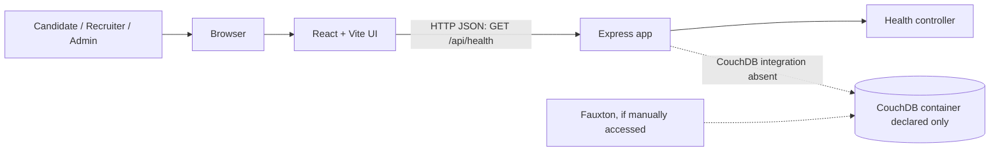
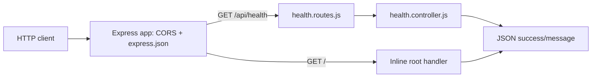
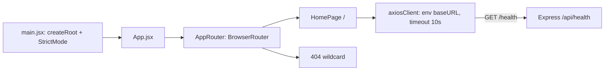
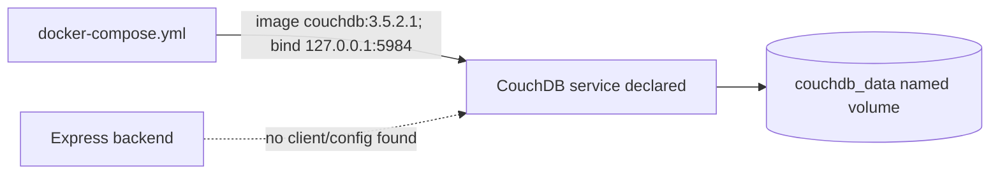
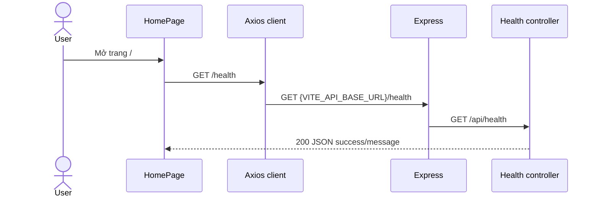
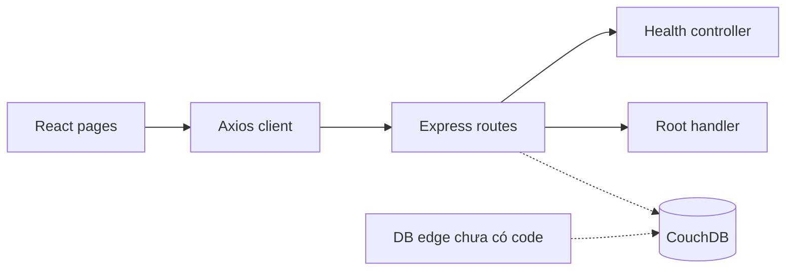

# RecruiHub NoSQL — Architecture & Database Audit

**Ngày audit:** 2026-10-22  
**Phạm vi:** `BaoCao/recruithub-nosql/` và `BaoCao/recruithub-team-work-assignment.md` trong workspace.  
**Phương pháp:** đọc source/manifests/config và tài liệu; không sửa mã, không chạy ứng dụng, không kết nối CouchDB.  
**Kết luận runtime:** **CHƯA XÁC MINH RUNTIME**. Các nhãn dưới đây: **VERIFIED FROM CODE**, **DECLARED ONLY**, **INFERRED**, **NOT FOUND**, **NOT VERIFIED**.

## 1. Executive Summary

Repo là một bootstrap full-stack nhỏ, chưa phải hệ thống tuyển dụng đã triển khai nghiệp vụ. Frontend React/Vite có trang home và 404; backend Express cung cấp `GET /` và `GET /api/health`; không có mã kết nối CouchDB, document/repository, auth, nghiệp vụ, scoring hay audit. **VERIFIED FROM CODE** — `frontend/src/{App.jsx,routes/AppRouter.jsx,pages/HomePage.jsx}`, `backend/src/{app.js,server.js}`.

CouchDB được khai báo trong Docker Compose (`couchdb:3.5.2.1`, port loopback 5984, named volume), nhưng chưa có client/backend config, database creation, schema/index/seed. Container có được chạy hay không và có database/dữ liệu gì đều **CHƯA XÁC MINH RUNTIME**. Tuyên bố trong tài liệu phân công rằng có `recruitment_db` với 25.750 documents chưa được chứng minh bằng source hoặc runtime.

Kiến trúc thực tế là một frontend và một backend trong cùng repo, backend hiện là HTTP bootstrap đơn giản. Chưa có bằng chứng về microservices hoặc modular monolith nghiệp vụ; gọi toàn hệ thống là monolith triển khai là **INFERRED**, do không có cấu hình triển khai frontend/backend ngoài Compose CouchDB.

## 2. Technology Stack thực tế

| Thành phần | Bằng chứng và trạng thái |
|---|---|
| Frontend | React, React DOM `^19.2.8`; Vite `^8.3.0`; JavaScript/JSX — **VERIFIED FROM CODE**, `frontend/package.json`. Phiên bản cài được khóa cụ thể trong lockfile; package manifest ghi range. |
| Router | `react-router-dom ^7.18.4`; `BrowserRouter`, `/`, `*` — **VERIFIED FROM CODE**, `frontend/src/routes/AppRouter.jsx`. |
| UI/CSS | CSS thuần (`index.css`, `App.css`), inline style ở HomePage; không thấy thư viện UI/Tailwind — **VERIFIED FROM CODE**. |
| State | React `useState`, `useEffect`; chưa có state manager/context — **VERIFIED FROM CODE**. |
| HTTP | Axios `^1.20.0`; shared instance timeout 10 giây — **VERIFIED FROM CODE**, `frontend/src/api/axiosClient.js`. |
| Backend | Node.js ES modules, Express `^5.2.1`; runtime Node version không được khóa (`engines`/`.nvmrc` không thấy) — package khai báo **VERIFIED FROM CODE**, runtime version **NOT VERIFIED**. |
| Middleware | `cors ^2.8.6`, `dotenv ^18.0.6`, Express JSON parser — **VERIFIED FROM CODE**. |
| Database | CouchDB image tag `3.5.2.1` được khai báo trong Compose — **DECLARED ONLY**; chưa có driver/client hoặc kết nối trong backend — **NOT FOUND**. Không thấy MongoDB/PostgreSQL hay database khác được dùng trong code. |
| Dev tooling | nodemon `^3.1.14`; frontend ESLint 10; không có test framework — **VERIFIED FROM CODE**. |
| Resume engine / external services | Scoring/AI engine chỉ được nêu trong tài liệu phân công, không có tích hợp thực tế — **NOT FOUND**. |

## 3. Repository Structure

Cây source thực tế (các thư mục rỗng không được Git/file listing thể hiện):

```text
recruithub-nosql/
├── backend/
│   ├── package.json, package-lock.json
│   └── src/{app.js,server.js,controllers/health.controller.js,routes/health.routes.js}
├── frontend/
│   ├── package.json, package-lock.json, vite.config.js
│   └── src/{main.jsx,App.jsx,App.css,index.css,api/axiosClient.js,
│            pages/HomePage.jsx,routes/AppRouter.jsx,assets/,}
├── docker-compose.yml
├── .env.example
├── ARCHITECTURE.md
└── README.md
```

`database/`, backend `config/`, `services/`, `repositories/`, `middleware/`, `schemas/` và frontend `features/`, `contexts/`, `hooks/`, `components/` là cấu trúc mục tiêu được nhắc trong tài liệu; không thấy implementation tương ứng trong file hiện có. **VERIFIED FROM CODE / NOT FOUND**.

## 4. System Architecture Diagram



Frontend→API health request là luồng thực tế. API→CouchDB và Fauxton truy cập là **chưa xác minh runtime**; Compose chỉ khai báo CouchDB, không chứng minh service đang chạy. Không có auth middleware, domain services, repository, scoring hay logging/audit trong sơ đồ vì source không có các thành phần đó.

## 5. Backend Architecture Diagram



Entry point `backend/src/server.js` nạp dotenv, lấy `PORT || 5000`, gọi `app.listen`. `app.js` khai báo CORS origin `FRONTEND_URL || http://localhost:5173`, JSON parser, route health và root route. Không có route/controller/service/repository nghiệp vụ. Error handler riêng, schema validation, auth/authz, rate limit, helmet, structured logger và worker đều **NOT FOUND**.

## 6. Frontend Architecture Diagram



Không có protected route, auth context, feature API, form hay nghiệp vụ. HomePage hiển thị chuỗi “Database: Apache CouchDB” nhưng đây chỉ là text UI, không phải bằng chứng kết nối.

## 7. Database Architecture Diagram



CouchDB được khai báo, còn trạng thái container/database và phiên bản đang chạy **CHƯA XÁC MINH RUNTIME**. Compose map credentials từ root `.env`; mẫu `.env.example` chứa placeholder. Không đọc/hiển thị giá trị `.env` thực. Không thấy Dockerfile, healthcheck, init script hay migration.

## 8. CouchDB Document Model

**Không có document model thực trong source.** Bảng sau là các loại được đề xuất trong `ARCHITECTURE.md`, nhãn **DECLARED ONLY**, không được hiểu là document tồn tại trong DB:

| Document | ID pattern được tài liệu đề xuất | Fields / references | Module sở hữu |
|---|---|---|---|
| user | `user:<id>` | Tài liệu mô tả role/status; schema/field đầy đủ không có trong code | Auth/Admin (mục tiêu) |
| candidate | `candidate:<id>` | Profile; tham chiếu user theo thiết kế | Candidate (mục tiêu) |
| recruiter | `recruiter:<id>` | Profile; tham chiếu user/company theo thiết kế | Recruiter (mục tiêu) |
| company | `company:<id>` | Không có schema code | Recruiter (mục tiêu) |
| department | `department:<id>` | Không có schema code | Recruiter (mục tiêu) |
| job | `job:<id>` | Requirements/status theo thiết kế | Job (mục tiêu) |
| application | `application:<id>` | Candidate/job/stage theo thiết kế | Application (mục tiêu) |
| interview | `interview:<id>` | Application/interview round theo thiết kế | Interview (mục tiêu) |
| resume_analysis | `analysis:<application_id>` | Score breakdown theo thiết kế | Scoring (mục tiêu) |

`_rev`, xử lý conflict, embedding/reference và denormalization chỉ là quy tắc kiến trúc trong tài liệu; không có triển khai hoặc bằng chứng DB. Không tìm thấy attachment, partitioning, `type` discriminator thực tế, audit-log document hay schema validation code.

## 9. Database Configuration

| Cấu hình | File | Giá trị không nhạy cảm | Mục đích | Trạng thái |
|---|---|---|---|---|
| Image | `docker-compose.yml` | `couchdb:3.5.2.1` | Khai báo dịch vụ | DECLARED ONLY |
| Port | `docker-compose.yml` | `127.0.0.1:5984:5984` | Bind CouchDB loopback | DECLARED ONLY |
| Volume | `docker-compose.yml` | `couchdb_data:/opt/couchdb/data` | Lưu dữ liệu bền vững | DECLARED ONLY |
| Credentials | `.env.example` | `COUCHDB_USER`, `COUCHDB_PASSWORD` (password mẫu là placeholder) | Compose environment | DECLARED ONLY; secret thực không được kiểm tra |
| Backend DB URL/timeout/retry/pool | Không thấy | — | Kết nối DB | NOT FOUND |
| DB name | README/ARCHITECTURE nhắc `recruitment_db` | — | Tên DB mục tiêu | DECLARED ONLY; chưa xác minh tồn tại |
| API base | `frontend/.env.example`, `axiosClient.js` | `VITE_API_BASE_URL=http://localhost:5000/api` | Frontend gọi backend | DECLARED ONLY; env hiệu lực lúc chạy chưa xác minh |
| Backend port | `server.js` | `PORT`, mặc định `5000` | HTTP listener | VERIFIED FROM CODE (default), runtime NOT VERIFIED |
| CORS | `app.js` | `FRONTEND_URL`, mặc định localhost:5173 | Cho phép frontend origin | VERIFIED FROM CODE (default), runtime NOT VERIFIED |

Không thấy cấu hình riêng development/test/production, backend `.env.example`, secret manager hoặc deploy target cho ứng dụng.

## 10. Index, Query, View

Không tìm thấy Mango selector/index, design document, MapReduce view, query, pagination hay sorting trong source. **NOT FOUND**. Không thể đánh giá full scan/thiếu index. README/ARCHITECTURE và tài liệu nhóm nói về Mango/View là thiết kế mục tiêu. Số lượng 25.750 docs trong assignment là **DECLARED ONLY**, không runtime verified. Không có script seed/migration/import/export/backup/restore trong source hiện hữu.

## 11. REST API Inventory

| Method | Endpoint | Handler | Service/Repository | Document | Auth/Role | Trạng thái |
|---|---|---|---|---|---|---|
| GET | `/` | Inline handler `backend/src/app.js` | Không có | — | Không có | VERIFIED FROM CODE |
| GET | `/api/health` | `health.routes.js` → `getHealth` | Không có | — | Không có | VERIFIED FROM CODE; chỉ xác nhận Express response, không xác nhận CouchDB |

Không tìm thấy API nghiệp vụ khác. Các endpoint `/api/v1/...` trong phân công là đề xuất/kế hoạch, không phải API đã triển khai. Frontend chỉ gọi `/health` qua Axios base URL (kết hợp dự kiến thành `/api/health`). Không có API nghiệp vụ mock hay kiểm thử API trong repo.

## 12. Data Flow & Sequence Diagrams

Chỉ workflow có code là health check:



Các workflow đăng ký/đăng nhập, cập nhật profile, browse/search jobs, apply, pipeline, interview, resume analysis/ranking và admin dashboard: **NOT FOUND — không có sequence thực để mô tả**. Tài liệu mô tả hành vi mục tiêu nhưng thiếu source để xác nhận luồng, auth, persistence hay trạng thái hoàn tất.

## 13. Module Dependency Diagram



Hiện không có module nghiệp vụ, shared domain contract hay import vòng nào nhìn thấy. Circular dependency: **NOT FOUND trong source hiện hữu**; repo còn nhỏ nên đây không phải chứng nhận cho code tương lai.

## 14. Dependency Matrix TV1/TV2/TV3

Phân công file/use case là kế hoạch, không phản ánh code hiện tại. Cả ba lát cắt bị chặn bởi nền tảng chung chưa có: database client/schema, validation/API contracts và auth. TV1 **không có phụ thuộc triển khai trực tiếp vào TV2/TV3** trong assignment; public job browse cần thống nhất contract/dữ liệu Job với TV2 về sau, nhưng đó là phụ thuộc hợp đồng tiềm năng.

| Module | Owner theo assignment | Depends On | Loại | Blocking? hiện tại | Hướng giảm nghẽn |
|---|---|---|---|---|---|
| Identity / Candidate / Public Portal | TV1 | CouchDB foundation; Job contract từ TV2 cho public browsing | shared foundation/API contract | Có: không có database/auth/API scaffold | Chốt user/profile/job DTO, auth response và ownership contract trước |
| Recruiter / Job / Application | TV2 | User/Candidate từ TV1; Job/Application schema; DB foundation | dữ liệu + contract | Có | Chốt enums, ID/reference, apply/stage transition và response envelope |
| Interview / Scoring / Audit | TV3 | Application/Job/Candidate từ TV1/TV2; scoring contract; DB foundation | dữ liệu + contract | Có | Stub contract/versioned DTO và mock fixtures; xác định rõ audit semantics |
| Shared platform (DB, validation, errors, enums) | Chưa giao owner rõ | Cả ba lát cắt | nền tảng | Có — điểm nghẽn lớn nhất | Chỉ định owner, thống nhất schema/contract, sau đó giao module song song |

Assignment có bất nhất cần giải quyết trước khi triển khai: ARCHITECTURE đề xuất rule-based weighted score, trong khi work assignment gọi “AI” scoring engine ngoài tên `recruithub-scoring-mvp-v1` và yêu cầu 246 tests; source không chứa engine, test hay integration nào. Số liệu 25.750 docs cũng chỉ xuất hiện ở assignment, không có dataset/script hoặc runtime evidence. Response contract trong assignment khác dạng response hiện tại của health/root.

## 15. Environment & Deployment Configuration

- `docker-compose.yml`: chỉ CouchDB, không có backend/frontend service, Dockerfile, healthcheck hoặc production deployment — **VERIFIED FROM CODE**.
- Root `.env.example`: CouchDB user/password placeholder; frontend `.env.example`: API base URL. Không xuất giá trị từ `.env` thực.
- Backend nạp `dotenv/config`; `PORT` mặc định 5000; CORS origin lấy `FRONTEND_URL` hoặc localhost:5173.
- Axios timeout 10.000 ms; không thấy retry/interceptor/auth token handling.
- Build tooling được khai báo; chưa chạy lint/build/test trong audit.
- Runtime hiện hành và config hiệu lực **NOT VERIFIED**.

## 16. Architecture Issues & Risks

| Mức | Phát hiện | Bằng chứng / tác động |
|---|---|---|
| HIGH | CouchDB chưa được backend sử dụng | Không có dependency/client/config/repository; Compose đơn thuần không tạo tích hợp dữ liệu. |
| HIGH | AuthN/AuthZ và validation chưa tồn tại | Không có middleware/schema; health/root public. Không có bảo vệ nghiệp vụ vì nghiệp vụ chưa được xây. |
| HIGH | Team assignment dựa trên tài sản chưa được xác minh | 25.750 docs và 246 tests không có bằng chứng ở repo; tránh lập kế hoạch dựa trên giả định đó. |
| MEDIUM | API/DB contract chưa được hiện thực hóa | Tài liệu có schema/response/enums mục tiêu nhưng source không có shared contract; health response cũng không theo đầy đủ envelope assignment. |
| MEDIUM | Error/security middleware và giới hạn vận hành tối thiểu chưa thấy | Không có error handler riêng, rate limiting, security headers, logging/audit; chưa có production hardening. |
| MEDIUM | Test chưa thiết lập | Backend `test` là lệnh placeholder cố tình exit 1; frontend không có test script/framework trong manifest. |
| LOW | CORS mặc định chỉ một origin dev nhưng phụ thuộc env khi triển khai | Khai báo trong `backend/src/app.js`; production origin chưa xác minh. |
| LOW | UI còn bootstrap/demo | HomePage hiện status và tên DB tĩnh; có thể khiến người xem hiểu nhầm DB đã kết nối. Đây là rủi ro thông tin, không phải bằng chứng kết nối. |

Không kết luận có lỗ hổng truy cập database hay dữ liệu production vì không có deployment/runtime để đánh giá.

## 17. Trình tự triển khai giảm nghẽn

1. Xác minh môi trường/dev CouchDB và nguồn dữ liệu thực; không dựa vào số liệu assignment cho tới khi read-only kiểm tra được.
2. Chốt shared contracts: role/status/stage enums, document IDs/references, response/error envelope, auth/ownership, scoring semantics và API versioning.
3. Giao owner cho nền tảng chung (DB config/client, validation, errors, logging và test harness); tạo interfaces/fixtures để các nhánh không phụ thuộc dữ liệu runtime.
4. TV1 xây identity/profile và public browse theo contract; TV2 xây job/application theo cùng DTO; tích hợp qua PR nhỏ.
5. TV3 làm interview/scoring/audit sau khi application/job contracts ổn định; có thể phát triển scoring thuần bằng fixtures nếu scoring inputs/outputs được chốt.
6. Thêm kiểm thử hợp đồng và tích hợp CouchDB, indexes/seed/migration an toàn; kiểm tra phân quyền/ownership trước khi nối UI nghiệp vụ.

Full-stack vertical slice phù hợp làm mục tiêu cho nhóm, nhưng repo hiện chưa đáp ứng: chưa có lát cắt nghiệp vụ nào ngoài health check. Nên khởi đầu theo vertical slice nhỏ sau khi nền tảng/contracts tối thiểu được thống nhất.

## 18. Thông tin chưa thể xác minh

- CouchDB container có đang chạy không; phiên bản runtime, database list, `recruitment_db`, document count và dữ liệu thực.
- Các credential thực, trạng thái env hiệu lực; không đọc/tiết lộ chúng trong báo cáo.
- Node/npm đang dùng, process backend/frontend đang chạy, route runtime ngoài source.
- Các tài sản được nhắc trong assignment nhưng không có trong repo (25.750 docs, 246 tests, scoring engine).
- Git state: workspace root không có metadata `.git` nên `git status`/remote không xác định được; không suy ra lịch sử/nhánh.
- API test coverage và runtime behavior. Không chạy lệnh test/build hay thao tác database trong audit này.

### Bằng chứng file chính

- Backend: `backend/package.json`, `backend/src/server.js`, `backend/src/app.js`, `backend/src/routes/health.routes.js`, `backend/src/controllers/health.controller.js`.
- Frontend: `frontend/package.json`, `frontend/src/main.jsx`, `frontend/src/App.jsx`, `frontend/src/routes/AppRouter.jsx`, `frontend/src/pages/HomePage.jsx`, `frontend/src/api/axiosClient.js`, `frontend/.env.example`.
- Hạ tầng: `docker-compose.yml`, `.env.example`.
- Tài liệu đối chiếu (không xem là bằng chứng runtime): `README.md`, `ARCHITECTURE.md`, `../recruithub-team-work-assignment.md`.
