# RecruiHub NoSQL — Use Case System

## 1. Tổng quan hệ thống

**RecruiHub NoSQL** là hệ thống quản lý tuyển dụng (Applicant Tracking System - ATS) tích hợp bộ tính toán điểm số phù hợp hồ sơ ứng viên (Resume–Job Match Scoring Engine), vận hành trên cơ sở dữ liệu hướng tài liệu **Apache CouchDB**.

Hệ thống có 4 Tác nhân (Actors) chính:

- **Candidate (Ứng viên)**: Người tìm kiếm việc làm, quản lý thông tin hồ sơ/kỹ năng, nộp đơn ứng tuyển và theo dõi tiến trình qua 7 stages.
- **Recruiter (Nhà tuyển dụng)**: Người tạo và quản lý tin tuyển dụng, theo dõi danh sách ứng viên, xem điểm số phù hợp do AI tính toán, xếp hạng ứng viên, lên lịch phỏng vấn và ra quyết định tuyển dụng.
- **Admin (Quản trị viên)**: Người quản lý người dùng toàn hệ thống, theo dõi thống kê số lượng tài liệu NoSQL trên CouchDB, giám sát log vận hành và vết kiểm toán.
- **AI Scoring Engine (Hệ thống tính điểm)**: Thành phần dịch vụ tự động (`recruithub-scoring-mvp-v1`) chịu trách nhiệm chuẩn hóa kỹ năng, so khớp yêu cầu công việc với hồ sơ ứng viên và tính toán điểm số phù hợp tổng hợp (Overall Match Score).

---

## 2. Sơ đồ Use Case tổng thể

```mermaid
flowchart TD
    C[Candidate - Ứng viên]
    R[Recruiter - Nhà tuyển dụng]
    A[Admin - Quản trị viên]
    AI[AI Scoring Engine]

    subgraph SYS["HỆ THỐNG RECRUIHUB NOSQL"]
        
        %% NHÓM 1: AUTH & PROFILE
        subgraph G1["1. Xác thực & Tài khoản"]
            UC01([UC01: Đăng ký tài khoản])
            UC02([UC02: Đăng nhập / Đăng xuất])
            UC03([UC03: Quản lý hồ sơ ứng viên])
            UC04([UC04: Quản lý thông tin Recruiter])
        end

        %% NHÓM 2: CANDIDATE
        subgraph G2["2. Tìm việc & Ứng tuyển"]
            UC05([UC05: Xem danh sách việc làm công khai])
            UC06([UC06: Lọc việc làm theo kỹ năng/lương/địa điểm])
            UC07([UC07: Xem chi tiết tin tuyển dụng])
            UC08([UC08: Nộp hồ sơ ứng tuyển])
            UC09([UC09: Theo dõi tiến độ đơn ứng tuyển - 7 stages])
            UC10([UC10: Rút đơn ứng tuyển])
        end

        %% NHÓM 3: RECRUITER
        subgraph G3["3. Quản lý Tuyển dụng & Phỏng vấn"]
            UC11([UC11: Đăng tin tuyển dụng mới])
            UC12([UC12: Quản lý & đóng tin tuyển dụng])
            UC13([UC13: Xem danh sách ứng viên nộp hồ sơ])
            UC14([UC14: Xem điểm số phù hợp AI Match Score])
            UC15([UC15: Xếp hạng ứng viên theo Job])
            UC16([UC16: Chuyển stage hồ sơ ứng viên])
            UC17([UC17: Lên lịch phỏng vấn])
            UC18([UC18: Ghi nhận kết quả & bằng chứng phỏng vấn])
        end

        %% NHÓM 4: AI SCORING
        subgraph G4["4. Phân tích Hồ sơ & Chấm điểm"]
            UC19([UC19: Chuẩn hóa kỹ năng và kinh nghiệm])
            UC20([UC20: Tính điểm Hard Skills Match])
            UC21([UC21: Tính điểm Experience & Domain Alignment])
            UC22([UC22: Tổng hợp Overall Match Score & Confidence])
        end

        %% NHÓM 5: ADMIN & MONITORING
        subgraph G5["5. Quản trị & Giám sát"]
            UC23([UC23: Quản lý người dùng])
            UC24([UC24: Khóa / Mở khóa tài khoản])
            UC25([UC25: Thống kê số lượng documents CouchDB])
            UC26([UC26: Tra cứu nhật ký hệ thống & audit trail])
        end

    end

    %% LIÊN KẾT CANDIDATE
    C --> UC01
    C --> UC02
    C --> UC03
    C --> UC05
    C --> UC06
    C --> UC07
    C --> UC08
    C --> UC09
    C --> UC10

    %% LIÊN KẾT RECRUITER
    R --> UC01
    R --> UC02
    R --> UC04
    R --> UC11
    R --> UC12
    R --> UC13
    R --> UC14
    R --> UC15
    R --> UC16
    R --> UC17
    R --> UC18

    %% LIÊN KẾT AI SCORING ENGINE
    UC14 -.-> UC19
    UC19 -.-> UC20
    UC20 -.-> UC21
    UC21 -.-> UC22
    AI --> UC19
    AI --> UC22

    %% LIÊN KẾT ADMIN
    A --> UC02
    A --> UC23
    A --> UC24
    A --> UC25
    A --> UC26
```

---

## 3. Đặc tả chi tiết từng Use Case

### 3.1. Nhóm 1: Xác thực & Quản lý Tài khoản

#### UC01: Đăng ký tài khoản
- **Actor:** Khách vãng lai.
- **Tiền điều kiện:** Chưa đăng nhập vào hệ thống.
- **Luồng chính:**
  1. Người dùng chọn "Đăng ký" và chọn vai trò mong muốn (`CANDIDATE` hoặc `RECRUITER`).
  2. Điền thông tin: Email, Mật khẩu, Họ và tên. (Nếu là Recruiter: bổ sung Tên công ty).
  3. Hệ thống kiểm tra tính duy nhất của Email trên CouchDB (`doc_type: "user"`).
  4. Hệ thống hash mật khẩu an toàn, tạo document `user` mới và tạo document `candidate` hoặc `recruiter` tương ứng.
  5. Trả về thông báo thành công và chuyển sang màn hình Đăng nhập.
- **Hậu điều kiện:** Document `user` mới được tạo với trạng thái `ACTIVE`.

#### UC02: Đăng nhập / Đăng xuất
- **Actor:** Candidate, Recruiter, Admin.
- **Luồng chính:**
  1. Người dùng nhập Email và Mật khẩu.
  2. Backend kiểm tra thông tin đăng nhập và trạng thái tài khoản (phải là `ACTIVE`).
  3. Tạo JWT Token chứa `user_id`, `role`, `email`.
  4. Trả về token và thông tin người dùng cho Frontend; Frontend lưu vào `localStorage` / Context và điều hướng về Dashboard tương ứng.
  5. Đăng xuất: Xóa token phía client và hủy phiên làm việc.

#### UC03: Quản lý hồ sơ ứng viên (Candidate Profile)
- **Actor:** Candidate.
- **Luồng chính:**
  1. Ứng viên xem trang thông tin cá nhân.
  2. Cập nhật danh sách kỹ năng chuyên môn (Hard Skills, Soft Skills).
  3. Cập nhật số năm kinh nghiệm, học vấn và liên kết CV/Resume text.
  4. Hệ thống validate bằng `CandidateProfileSchema` và lưu bản cập nhật vào CouchDB.

---

### 3.2. Nhóm 2: Tìm kiếm Việc làm & Nộp Hồ sơ (Candidate)

#### UC05 & UC06: Xem và lọc danh sách tin tuyển dụng công khai
- **Actor:** Khách vãng lai, Candidate.
- **Luồng chính:**
  1. Hệ thống truy vấn các Job có trạng thái `status: "OPEN"` từ CouchDB.
  2. Hỗ trợ lọc theo:
     - Kỹ năng (VD: JavaScript, Python, React, NoSQL).
     - Địa điểm làm việc (Hà Nội, TP.HCM, Remote...).
     - Khoảng mức lương (Min/Max salary).
  3. Hỗ trợ phân trang mượt mà (Pagination) và sắp xếp theo ngày đăng mới nhất.

#### UC07: Xem chi tiết tin tuyển dụng
- **Actor:** Candidate, Khách vãng lai.
- **Luồng chính:**
  1. Người dùng bấm vào thẻ việc làm từ danh sách.
  2. Hệ thống tải thông tin đầy đủ của Job: Mô tả công việc, trách nhiệm, yêu cầu kỹ năng bắt buộc, đãi ngộ, hạn nộp hồ sơ.
  3. Nếu ứng viên đã đăng nhập, hiển thị trạng thái đã nộp hay chưa.

#### UC08: Nộp hồ sơ ứng tuyển (Apply Job)
- **Actor:** Candidate.
- **Tiền điều kiện:** Đã đăng nhập vai trò `CANDIDATE`, Job có trạng thái `OPEN`.
- **Luồng chính:**
  1. Ứng viên bấm "Nộp hồ sơ" tại trang chi tiết việc làm.
  2. Modal hiển thị: Kiểm tra thông tin hồ sơ hiện có, cho phép cập nhật Resume Text/Cover Letter cho vị trí này.
  3. Bấm xác nhận nộp hồ sơ.
  4. Backend kiểm tra:
     - Ứng viên chưa từng nộp đơn đang trong tiến trình cho Job này.
     - Job vẫn đang mở (`OPEN`).
  5. Khởi tạo document `application` với `current_stage: "APPLIED"`, tạo bản ghi lịch sử `stage_history: [{ stage: "APPLIED", changed_at: ISO }]`.
  6. Tự động kích hoạt tính toán điểm số sơ bộ ban đầu thông qua Scoring Engine.
- **Hậu điều kiện:** Document `application` được tạo trong CouchDB, gắn mã định danh duy nhất.

#### UC09: Theo dõi tiến độ hồ sơ qua 7 Stages
- **Actor:** Candidate.
- **Luồng chính:**
  1. Ứng viên truy cập Bảng điều khiển (`/user/dashboard`).
  2. Xem danh sách các công việc đã nộp kèm huy hiệu trạng thái hiện tại.
  3. Bấm vào chi tiết để xem thanh tiến trình (Timeline) 7 stages:
     - `APPLIED`: Đã nộp hồ sơ.
     - `SCREENING`: Đang sàng lọc hồ sơ.
     - `INTERVIEWING`: Đang tham gia các vòng phỏng vấn.
     - `OFFERED`: Nhận được lời mời nhận việc.
     - `HIRED`: Đã được tuyển dụng thành công.
     - *(Hoặc `REJECTED`: Bị từ chối / `WITHDRAWN`: Đã rút đơn).*

#### UC10: Rút đơn ứng tuyển (Withdraw Application)
- **Actor:** Candidate.
- **Tiền điều kiện:** Đơn ứng tuyển đang ở các stage `APPLIED`, `SCREENING` hoặc `INTERVIEWING` (chưa ở trạng thái `HIRED` hoặc `REJECTED`).
- **Luồng chính:**
  1. Ứng viên bấm nút "Rút đơn" và xác nhận lý do.
  2. Backend cập nhật `current_stage = "WITHDRAWN"`, bổ sung vào `stage_history`.

---

### 3.3. Nhóm 3: Quản lý Tuyển dụng & Phỏng vấn (Recruiter)

#### UC11 & UC12: Đăng tin & Quản lý tin tuyển dụng
- **Actor:** Recruiter.
- **Luồng chính:**
  1. Nhà tuyển dụng điền thông tin: Tiêu đề công việc, mô tả, danh sách kỹ năng yêu cầu (Hard skills), số năm kinh nghiệm tối thiểu, học vấn, mức lương.
  2. Chọn trạng thái: Lưu nháp (`DRAFT`) hoặc Đăng công khai (`OPEN`).
  3. Khi hết hạn tuyển dụng hoặc đã tuyển đủ người, Recruiter có quyền đóng tin tuyển dụng (`status = "CLOSED"`).

#### UC13 & UC14: Xem danh sách ứng viên & Điểm số AI Match Score
- **Actor:** Recruiter.
- **Luồng chính:**
  1. Recruiter mở trang quản lý ứng viên của một tin tuyển dụng cụ thể.
  2. Hệ thống tải toàn bộ document `application` của Job đó kèm theo document `resume_analysis` tương ứng.
  3. Hiển thị bảng danh sách ứng viên kèm:
     - Họ tên ứng viên.
     - Ngày nộp.
     - Stage hiện tại.
     - **Overall Match Score (%)**: Huy hiệu điểm số được mã hóa màu sắc (Xanh lá $\ge 80\%$, Xanh lam $60-79\%$, Cam $< 60\%$).
  4. Recruiter bấm vào điểm số để mở ngăn chi tiết (Score Breakdown Drawer):
     - Tỷ lệ trùng khớp kỹ năng bắt buộc (Hard Skills Overlap).
     - Danh sách kỹ năng trùng và kỹ năng còn thiếu.
     - Đánh giá kinh nghiệm (Experience Match).
     - Độ tương đồng ngành nghề (Domain Alignment).

#### UC15: Xếp hạng ứng viên theo Job (Deterministic AI Ranking)
- **Actor:** Recruiter.
- **Luồng chính:**
  1. Recruiter bấm "Sắp xếp theo Điểm phù hợp AI".
  2. Hệ thống sắp xếp danh sách theo thứ tự ưu tiên:
     - Điểm `overall_score` từ cao xuống thấp.
     - Nếu bằng điểm: Ưu tiên ứng viên có điểm `hard_skills_score` cao hơn.
     - Nếu tiếp tục bằng: Ưu tiên ứng viên nộp hồ sơ sớm hơn (`created_at`).

#### UC16: Chuyển Stage hồ sơ ứng viên
- **Actor:** Recruiter.
- **Luồng chính:**
  1. Recruiter chọn hành động chuyển trạng thái cho ứng viên (VD: Chuyển từ `SCREENING` sang `INTERVIEWING`).
  2. Hệ thống kiểm tra quy tắc chuyển đổi hợp lệ (không nhảy cóc bất thường).
  3. Cập nhật `current_stage`, thêm bản ghi mới vào mảng `stage_history` kèm thời điểm và ghi chú.

#### UC17 & UC18: Lên lịch & Ghi nhận kết quả phỏng vấn
- **Actor:** Recruiter.
- **Luồng chính:**
  1. Khi ứng viên ở stage `INTERVIEWING`, Recruiter chọn "Lên lịch phỏng vấn".
  2. Nhập thông tin: Vòng phỏng vấn (Vòng 1 - Kỹ thuật, Vòng 2 - Văn hóa...), thời gian, hình thức, người phỏng vấn.
  3. Tạo document `interview` mới gắn với `application_id`.
  4. Sau khi phỏng vấn xong: Recruiter nhập điểm đánh giá (Rating từ 1-5 sao), ghi nhận bằng chứng đánh giá (Evidence notes) và chọn kết quả (`PASSED` hoặc `FAILED`).

---

### 3.4. Nhóm 4: Phân tích Hồ sơ & Thuật toán Chấm điểm (AI Scoring Engine)

#### UC19 - UC22: Quy trình tính điểm hồ sơ chuẩn xác
- **Actor:** AI Scoring Engine (`recruithub-scoring-mvp-v1`).
- **Luồng xử lý tự động:**
  1. **Chuẩn hóa (Normalization)**: Đưa toàn bộ kỹ năng của Job và Candidate về dạng chữ thường, loại bỏ khoảng trắng thừa và ký tự đặc biệt (VD: `node.js` -> `nodejs`, `c++` -> `cpp`).
  2. **Tính điểm kỹ năng (Hard Skills Score)**:
     - So khớp tập hợp kỹ năng ứng viên sở hữu với tập hợp kỹ năng Job yêu cầu.
     - Điểm kỹ năng = $\frac{\text{Số kỹ năng trùng khớp}}{\text{Tổng số kỹ năng yêu cầu}} \times 100$.
  3. **Tính điểm kinh nghiệm (Experience Score)**:
     - So sánh số năm kinh nghiệm thực tế với số năm yêu cầu của Job.
     - Đạt hoặc vượt yêu cầu: 100 điểm. Dưới yêu cầu: Tính tỷ lệ suy giảm tương ứng.
  4. **Tính điểm chuyên ngành (Domain Relevance)**:
     - Tính mức độ trùng khớp giữa ngành nghề của Job và lĩnh vực ứng viên đã làm việc.
  5. **Tính điểm tổng hợp (Overall Score)**:
     $$\text{Overall Score} = 0.5 \times \text{HardSkills} + 0.3 \times \text{Experience} + 0.2 \times \text{Domain}$$
  6. **Đánh giá độ tin cậy (Confidence & Freshness)**:
     - Xác định trạng thái hồ sơ: `COMPLETE` (đầy đủ thông tin) hoặc `INCOMPLETE` (thiếu dữ liệu kỹ năng hoặc kinh nghiệm).
     - Lưu trữ fingerprint và kết quả vào document `resume_analysis`.

---

### 3.5. Nhóm 5: Quản trị & Giám sát Hệ thống (Admin)

#### UC23 & UC24: Quản lý người dùng & Khóa tài khoản
- **Actor:** Admin.
- **Luồng chính:**
  1. Admin xem danh sách toàn bộ người dùng trong hệ thống.
  2. Tìm kiếm theo Email, Tên, hoặc lọc theo Vai trò (`ADMIN`, `RECRUITER`, `CANDIDATE`).
  3. Khóa tài khoản (`SUSPENDED` / `INACTIVE`) nếu phát hiện vi phạm hoặc mở khóa tài khoản.

#### UC25: Thống kê dữ liệu NoSQL CouchDB
- **Actor:** Admin.
- **Luồng chính:**
  1. Admin mở Bảng điều khiển Quản trị (`/admin/dashboard`).
  2. Hệ thống gọi MapReduce View `_design/stats/_view/by_doc_type` trên CouchDB.
  3. Hiển thị biểu đồ và số liệu trực quan:
     - Tổng số documents trong `recruitment_db` (25.750).
     - Số lượng chi tiết theo 9 loại: Users, Candidates, Recruiters, Jobs, Applications, Interviews, Resume Analyses, Logs, Audit Trails.
     - Tỷ lệ phân bổ trạng thái tin tuyển dụng (`OPEN` vs `DRAFT`).

#### UC26: Tra cứu Nhật ký & Vết kiểm toán
- **Actor:** Admin.
- **Luồng chính:**
  1. Xem nhật ký hoạt động hệ thống (`system_log`) theo dòng thời gian.
  2. Tra cứu vết kiểm toán (`audit_trail`) để theo dõi các thao tác nhạy cảm: Đổi stage ứng viên, thay đổi quyền người dùng, cập nhật trạng thái Job.

---

## 4. Ma trận Phân quyền (RBAC Matrix)

| Chức năng / Thao tác | Khách vãng lai | Candidate | Recruiter | Admin |
| :--- | :---: | :---: | :---: | :---: |
| Đăng ký, Đăng nhập | ✅ | ✅ | ✅ | ✅ |
| Xem danh sách & Chi tiết Job công khai | ✅ | ✅ | ✅ | ✅ |
| Cập nhật hồ sơ cá nhân | ❌ | ✅ (Chính mình) | ✅ (Công ty mình) | ❌ |
| Nộp đơn ứng tuyển (Apply) | ❌ | ✅ | ❌ | ❌ |
| Theo dõi tiến trình 7 stages của đơn | ❌ | ✅ (Đơn của mình) | ❌ | ❌ |
| Rút đơn ứng tuyển (Withdraw) | ❌ | ✅ (Đơn của mình) | ❌ | ❌ |
| Đăng tin & Quản lý Job | ❌ | ❌ | ✅ (Job của mình) | ✅ |
| Xem ứng viên nộp vào Job | ❌ | ❌ | ✅ (Job của mình) | ✅ |
| Xem điểm AI Match Score & Xếp hạng | ❌ | ❌ | ✅ (Job của mình) | ✅ |
| Chuyển stage hồ sơ ứng viên | ❌ | ❌ | ✅ (Job của mình) | ✅ |
| Lên lịch & Đánh giá phỏng vấn | ❌ | ❌ | ✅ (Job của mình) | ✅ |
| Quản lý tài khoản người dùng | ❌ | ❌ | ❌ | ✅ |
| Xem thống kê CouchDB toàn hệ thống | ❌ | ❌ | ❌ | ✅ |
| Tra cứu System Logs & Audit Trail | ❌ | ❌ | ❌ | ✅ |
