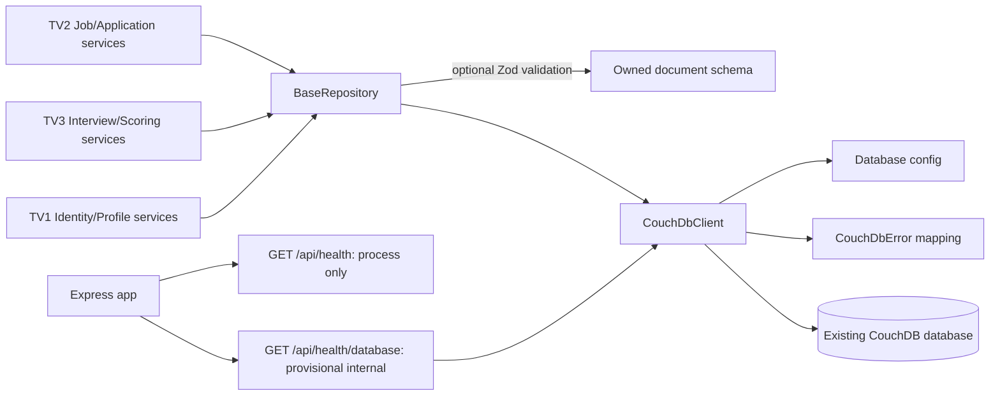

# RecruiHub NoSQL — Shared CouchDB Foundation Contract

**Version:** 0.1 — source-aligned handoff draft, 2026-10-23  
**Status:** Interface descriptions are verified from source; integration proposals remain pending unless marked approved below.  
**Owners:** TV1 Shared Foundation; TV2 Job/Application; TV3 Interview/Scoring/Audit.

## 1. Authority and status labels

This document describes current implementation, approved DATA-02A data contract, and proposals that require group confirmation. It does not make an unapproved proposal official.

- **IMPLEMENTED:** present in current source and/or covered by current tests.
- **APPROVED:** explicitly locked by DATA-02A/business rules or Stage 03C task.
- **PROPOSED:** recommended for adoption; not yet a team decision.
- **PENDING:** no source-level implementation or recorded approval; requires a decision.

Approved boundaries: TV1 owns shared foundation; TV2 owns Job/Application; TV3 owns Interview/Scoring/Audit; exactly nine business document types use discriminator `type`; foundation does not create business IDs/types, retry mutations, write `recruitment_db` in foundation tests, or create indexes/views/document types.

## 2. Architecture and dependency flow

Importing the client, repository, or route does not issue a CouchDB request. The runtime readiness handler constructs the client only when called. `find()` uses CouchDB `_find` through HTTP POST as a query operation; it is not a document mutation.

## 3. File and module ownership

| Area | Owner | Current files / boundary |
|---|---|---|
| Shared DB config and environment loading | TV1 | `backend/src/config/database.config.js`, `backend/src/config/load-environment.js` |
| CouchDB HTTP client and typed DB errors | TV1 | `backend/src/services/couchdb.client.js`, `backend/src/services/couchdb.errors.js` |
| Base repository and provisional response helpers | TV1 | `backend/src/repositories/base.repository.js`, `backend/src/utils/api-response.js` |
| Readiness route | TV1 foundation | `backend/src/routes/database-health.routes.js`, mounted in `backend/src/app.js` |
| User/Candidate/Recruiter business operations | TV1 | Not implemented as part of this foundation contract |
| Job/Application schema usage, repository, service and APIs | TV2 | TV2 owns domain behavior; use shared foundation, do not duplicate it |
| Interview/Scoring/Audit schema usage, repository, service and APIs | TV3 | TV3 owns domain behavior; use shared foundation, do not duplicate it |
| Cross-module API/auth/error contract | Joint owners to confirm | PENDING; no shared implementation freeze recorded |
| CouchDB index/view lifecycle | Shared owner to assign after query contracts | PENDING; none is created by foundation |

## 4. Approved document contract

`type` is the approved discriminator. Foundation accepts caller-provided documents and never supplies the business `_id` or `type`.

| Type | Approved `_id` pattern | Owning domain |
|---|---|---|
| `user` | `user:<sha256(canonical email_normalized)>` | TV1 |
| `candidate` | `candidate:cms:<resume_id>` for audited source records | TV1 |
| `recruiter` | `recruiter:<stable-id>` | TV1 |
| `company` | `company:<stable-id>` | TV2 organization domain / shared reference |
| `department` | `department:<stable-id>` | TV2 organization domain / shared reference |
| `job` | `job:cms:<job_id>` for audited source records | TV2 |
| `application` | `application:pair:<sha256(candidate_id + "\n" + job_id)>` | TV2 |
| `interview` | `interview:<application-key>:<round>` | TV3 |
| `resume_analysis` | `analysis:<application_id>` | TV3 |

DATA-02A is authoritative for full fields, provenance, references and lifecycle rules. Do not add audit/session as a tenth type without a separately approved schema change.

## 5. Public interface contract: CouchDbClient and BaseRepository

Outputs are current CouchDB/client pass-through behavior; the client does not add a domain DTO. Native input errors are possible where a precondition is violated.

| Method | Input | Output | Errors | Preconditions | Side effects | Example | Owner |
|---|---|---|---|---|---|---|---|
| `CouchDbClient.checkReadiness()` | None | `{ ready: true, server, database }` | `DATABASE_NOT_FOUND`, `AUTHENTICATION_ERROR`, `AUTHORIZATION_ERROR`, `NETWORK_ERROR`, `TIMEOUT`, `SERVER_ERROR`, `HTTP_ERROR`, `INVALID_RESPONSE` | Config valid; server and configured DB reachable | Two GET requests: `/`, then `/{db}`; no writes | `await client.checkReadiness()` | TV1 foundation; ops caller |
| `BaseRepository.getById(id)` → `client.getDocument(id)` | Non-empty string ID | CouchDB document JSON | `NOT_FOUND`, database/auth/network/timeout/server errors; `TypeError` for invalid ID | Caller supplies exact deterministic ID | One GET document | `await repo.getById(id)` | Owning module |
| `BaseRepository.find(selector, options={})` → `client.find(query)` | Object selector; options are Mango query options | CouchDB `_find` response, normally including `docs` and optionally `bookmark`/`warning`; pass-through | CouchDB typed errors; `TypeError` for non-object selector/query | Caller validates/allowlists selector and options | HTTP POST to `/{db}/_find`; query/read only; no index is created | `await repo.find({type:'job'}, {limit:25})` | Owning module |
| `BaseRepository.create(document)` → `client.createDocument(document)` | JSON object with deterministic non-empty `_id`, without `_rev` | CouchDB PUT response `{ok,id,rev}` | `DOCUMENT_VALIDATION_FAILED`, `TypeError`, `CONFLICT`, auth/network/timeout/server errors | Optional configured Zod schema passes; `_id` supplied; `_rev` absent | One document PUT/write | `await repo.create(validatedDocument)` | Owning module; not for unapproved live test DB |
| `BaseRepository.update(document, expectedRev)` → `client.updateDocument(...)` | Object with `_id`; explicit expected revision | CouchDB PUT response `{ok,id,rev}` | `DOCUMENT_VALIDATION_FAILED`, `TypeError`, `CONFLICT`, auth/network/timeout/server errors | Optional schema passes; non-empty `expectedRev`; any document `_rev` equals expected value | One document PUT/write; no automatic retry | `await repo.update(document, document._rev)` | Owning module |
| `BaseRepository.exists(id)` → `client.exists(id)` | Non-empty string ID | `true` if GET succeeds; `false` only for missing document | Missing DB/auth/network/timeout/server errors still throw | Configured database exists | One GET document; no write | `await repo.exists(id)` | Owning module |
| `BaseRepository.getDatabaseInfo()` → `client.getDatabaseInfo()` | None | CouchDB database metadata JSON, including `db_name`/`doc_count` | `DATABASE_NOT_FOUND`, auth/network/timeout/server errors | Config valid; DB exists | One GET `/{db}`; no write | `await repo.getDatabaseInfo()` | TV1 foundation / diagnostics caller |

The CouchDbClient also exposes `getDocument(id)`, `find(query)`, `createDocument(document)`, `updateDocument(document, expectedRev)`, and `exists(id)` with the same delegated semantics above.

`BaseRepository` does not replace service-level authorization, role checks, ownership checks, state-transition validation, idempotency, DTO mapping, or audit policy. Zod `safeParse` is a pass/fail check; parsed/transformed output is not substituted for the caller's document. The repository validates only on `create` and `update`; reads and `find` results are not schema-validated.

## 6. Database configuration and error contract

### Configuration

`getDatabaseConfig(environment=process.env)` returns frozen `{url,database,username,password,timeoutMs}`. Defaults: `COUCHDB_URL=http://127.0.0.1:5984`, `COUCHDB_DATABASE=recruitment_db`, `COUCHDB_TIMEOUT_MS=5000`; timeout range 100–60000 ms. Credentials are optional but `COUCHDB_USER` and `COUCHDB_PASSWORD` must appear together. URL must be HTTP(S), server-root only, with no URL userinfo. Invalid input throws `INVALID_DATABASE_CONFIG`. Config contains password when configured; never log or serialize it.
`COUCHDB_URL` validation permits any HTTP(S) server-root URL; it is not restricted to loopback. **PENDING:** deployment must explicitly allowlist the intended CouchDB host and protect outbound credential use.

At startup, `loadBackendEnvironment()` reads existing `backend/.env` then root `.env`; process values win, and backend file wins over root when both supply a missing process key. Loader is read-only and resolves paths from source, not current working directory.

### Configuration, CouchDbError and readiness route interfaces

| Interface | Input | Output | Errors | Preconditions | Side effects | Example | Owner |
|---|---|---|---|---|---|---|---|
| `getDatabaseConfig(environment=process.env)` | Environment-like object | Frozen `{url,database,username,password,timeoutMs}` | `INVALID_DATABASE_CONFIG` (message contains issue paths/messages, not values) | URL/name/credential pair/timeout satisfy Zod rules | No network or env mutation | `const config = getDatabaseConfig(process.env)`; never log `config` | TV1 |
| `new CouchDbError(code,message,{status,operation,cause})` | Stable code, safe message, optional upstream status/operation/cause | Error object with `code`, `status`, `operation`, internal `cause` | No network error itself; consumers throw it | Message must be sanitized by caller/mapping | Constructs an in-memory error only | `throw new CouchDbError('CONFLICT', 'Revision conflict')` | TV1 |
| `toApiError(error)` | Error | `{status,body}` sanitized HTTP mapping | Unknown error maps to generic 500 | Used by route/controller boundary | No network/database effect | `const mapped = toApiError(error)` | TV1 foundation; API owners approve shared policy |
| `GET /api/health/database` | HTTP GET; no request body or query required | 200 `{success:true,data:{status:'ready',database:{name,doc_count}},message}` | Config failure 503 generic; `DATABASE_NOT_FOUND`/auth/network 503; timeout 504; CouchDB 5xx 502; unexpected 500 | Valid config and accessible CouchDB server/database | Two CouchDB GET requests only; no write/index/view | `curl.exe -i http://127.0.0.1:5002/api/health/database` | TV1 foundation; exposure policy pending |

The readiness router factory also accepts `{clientFactory}` for tests; this is dependency injection, not a public request parameter. The route currently has no authentication and is provisional/internal.

### CouchDbError and related errors

| Code | Meaning / current mapping |
|---|---|
| `BAD_REQUEST` | CouchDB HTTP 400 |
| `AUTHENTICATION_ERROR` | HTTP 401 |
| `AUTHORIZATION_ERROR` | HTTP 403 |
| `NOT_FOUND` | Missing document/resource when not identified as missing DB |
| `DATABASE_NOT_FOUND` | HTTP 404 for configured DB |
| `CONFLICT` | HTTP 409; includes stale revision conflict |
| `SERVER_ERROR` | CouchDB HTTP 5xx |
| `HTTP_ERROR` | Other unexpected HTTP response |
| `NETWORK_ERROR` | Fetch/network failure |
| `TIMEOUT` | Abort caused by configured timeout |
| `INVALID_RESPONSE` | Successful HTTP response body is not valid JSON |
| `DOCUMENT_VALIDATION_FAILED` | BaseRepository Zod validation failure (separate error class) |
| `INVALID_DATABASE_CONFIG` | Configuration parsing failure (plain Error with stable `code`) |

`CouchDbError` carries `code`, sanitized `message`, optional HTTP `status`, `operation` and internal `cause`. `toApiError()` omits cause, URL, response body and credentials. **Implemented mapping:** `BAD_REQUEST` 400, `NOT_FOUND` 404, `CONFLICT` 409, authentication/authorization/network/database-missing 503, timeout 504, `SERVER_ERROR`/`HTTP_ERROR` 502, and unknown errors 500. **Proposed shared domain API mapping:** validation 400, unauthenticated 401, forbidden 403, missing resource 404, conflict 409, rate limiting 429, dependency unavailable 503, dependency timeout 504, upstream failure 502, unexpected application failure 500. The proposed map is not implemented on every route and still needs approval.

## 7. API integration contract register

| Topic | Current source | Proposal | Status |
|---|---|---|---|
| API prefix | Implemented operational route `/api/health`; readiness `/api/health/database`; architecture/frontend materials also mention `/api/v1` | Keep `/api` as current MVP root for new endpoints, avoiding an unapproved health migration. Resolve `/api/v1` mismatch jointly before domain integration. | **PENDING** approval; current routes **IMPLEMENTED** |
| Success/error envelope | Helpers exist; readiness success uses `{success:true,data,message}`; legacy health body differs; `toApiError` returns `{success:false,error:{code,message,details}}` | Freeze `{success:true,data,message?}` and `{success:false,error:{code,message,details}}`; allow legacy ops health exception or migrate only by versioned decision. | **PROPOSED** |
| HTTP statuses | CouchDbError mapper partially implements dependency/error statuses | Use standard 400/401/403/404/409/429/500 plus 502/503/504 for dependency failures. Define per-code exceptions with API owners. | **PROPOSED** |
| Cursor pagination | No pagination abstraction; Mango options and response are passed through, including bookmark when CouchDB returns it | API exposes bounded `limit`, opaque `nextCursor`; cursor binds bookmark to normalized selector/sort and rejects mismatched query. Require stable sort and unique tie-breaker. | **PENDING** design/approval |
| Error sanitization | **IMPLEMENTED** in CouchDbError/toApiError for known mapped errors; unexpected errors use generic message | Preserve no-stack/no-secret/no-raw-upstream-response rule and redact sensitive validation details. | **IMPLEMENTED** baseline; extensions **PROPOSED** |
| Auth principal | No auth middleware or request principal exists | Middleware supplies server-verified `req.auth={userId,role}` using canonical uppercase role; resolve ownership/scope from authoritative docs, not caller fields. | **PENDING**; no auth implementation |
| Readiness endpoint | `GET /api/health/database` is implemented; allowlist response contains status, DB name and document count; no auth | Keep local/internal only or protect through approved ops boundary before wider deployment; consider hiding count if not needed. | Endpoint **IMPLEMENTED**; exposure policy **PENDING** |

Existing `GET /api/health` remains process-only and returns its legacy body. It does not prove DB readiness.

## 8. Mango query conventions and pagination

**Implemented:** `BaseRepository.find(selector, options)` requires an object selector, then builds `{...options, selector}`. `CouchDbClient.find(query)` sends it to CouchDB `/{db}/_find` using POST. There is no option schema, filter allowlist, implicit `type`, `limit` cap, stable sort, bookmark wrapper, or index selection in Foundation.

**Required consumer practice:**

1. Build selectors in the service from an explicit allowlist; never pass arbitrary request JSON into Mango.
2. Constrain to the owned `type` and authorized scope where applicable.
3. Cap `limit` and validate fields/operators/sort against the module API contract.
4. For cursor pagination, return an opaque server cursor containing/binding CouchDB bookmark, normalized query identity and sort/version; reject a cursor for a different selector.
5. Use deterministic sort with a unique final tie-breaker (often `_id`) and test page boundaries when records share earlier sort keys.
6. Submit index/view proposals from measured selectors/sort and expected volume; do not create indexes as a side effect of repository use.

Bookmark/cursor mechanics and exact API shape are **PENDING**, not implemented by BaseRepository.

## 9. `_rev` / 409 conflict policy

**Implemented:** update requires caller-provided `expectedRev`; client passes it as `_rev`, rejects a mismatching document `_rev`, and maps CouchDB 409 to `CONFLICT`. Client does not re-read or retry.

**Approved data rule:** DATA-02A requires fresh `_rev`, re-read/re-evaluate on conflict and no blind overwrite. Its detailed rule permits at most one retry only when the action remains clearly valid and idempotency is established.

**Conflict in project instructions:** `AGENTS.md` says retry automatically up to three times; DATA-02A says at most one conditional retry. **PROPOSED (not approved):** use DATA-02A's stricter domain rule for business mutations: read fresh revision, recheck authorization, state transition and idempotency, retry at most once only if valid, then return HTTP 409 on another conflict. Group confirmation is required before any service codifies this. No automatic retry belongs in shared client.

## 10. Testing rules

- Foundation unit tests use fake Fetch/client and do not write to CouchDB.
- `node --test tests/foundation/*.test.js` runs isolated Foundation tests (18/18 at Stage 03B verification).
- Do not run create/update tests against `recruitment_db`; use a separately approved isolated test DB for live writes.
- Read-only verification may call readiness, metadata, document GET and Mango `_find`; `_find` is HTTP POST but query-only.
- Legacy `npm.cmd test` runs `tests/data/*.test.js`; some tests manipulate shared `data/` scratch/release paths. Inspect side effects and isolate before running; a historical run failed on checksum/path/release/failure-injection cases.
- Stage 03C tests do not write database state; this task runs Foundation tests only.

## 11. Environment setup and readiness

Backend reads process env first, then `backend/.env`, then root `.env`. Do not copy credentials or print `.env` values. From root PowerShell use `$env:PORT='5002'; npm.cmd --prefix backend run dev`; from `backend/` use `$env:PORT='5002'; npm.cmd run dev`. Process-supplied env is preserved. Default PORT remains 5000.

`GET /api/health` checks Express only. `GET /api/health/database` performs CouchDB server-root and configured database GETs, returning readiness/database name/doc_count. It does not create a database, index, view or document. Timeout follows `COUCHDB_TIMEOUT_MS` (default 5000 ms). Route has no auth and must remain internal until exposure is approved.

## 12. Security boundaries

- Browser code must not connect to CouchDB or receive CouchDB credentials.
- Keep URL userinfo prohibited; Basic auth header is made per request and never logged.
- Config object includes password: do not log, JSON-serialize or pass it to controllers.
- BaseRepository does not enforce auth/ownership; services must verify canonical user/role and resource scope.
- Sanitize errors and validation detail before public response; never return private document content on `_rev` conflict.
- Readiness is operational metadata, not authentication. Current route has no auth; restrict network exposure.
- Audit persistence, retention and reader authorization are PENDING TV3/team decisions. Do not invent a tenth document type.

## 13. Versioning and change control

Foundation public method names and current signatures are source contracts for this handoff, not an immutable semver guarantee. Additive changes require tests and guide updates. A breaking signature/error change requires a versioned proposal and review by TV1 plus consuming TV2/TV3 owners. Domain IDs, state transitions, DTOs and query policy remain owned by the relevant module. Do not edit another module's behavior through a shared-layer change without review.

## 14. Known limitations

- No business repositories, authentication, API principal, authorization, transactions or multi-document atomic writes.
- No delete, bulk API, database creation, migrations, seed, index/view management or client mutation retries.
- `find` is a raw Mango pass-through and can cause scans if callers do not provide appropriate selectors/indexes.
- Zod schemas are optional and only used for create/update; read results are not validated. Zod transform output is not applied.
- No pagination helper/stable ordering contract.
- Response helpers/envelope are not globally standardized.
- Readiness route has no auth and is provisional internal.
- Retry count, API prefix/envelope, principal, cursor contract and index owner are pending.

## 15. Decision register

| Decision | Status | Evidence / action |
|---|---|---|
| TV1 owns shared foundation | **APPROVED** | Stage 03A ownership prompt and implementation/report |
| TV2 owns Job/Application | **APPROVED** | Team assignment and current handoff scope |
| TV3 owns Interview/Scoring/Audit | **APPROVED** | Team assignment and current handoff scope |
| Exactly nine business types; discriminator `type` | **APPROVED** | DATA-02A; no tenth type |
| Foundation never generates business ID/type | **APPROVED + IMPLEMENTED** | DATA-02A and source behavior |
| No test writes to `recruitment_db` | **APPROVED** | Stage 03A/03C task boundary |
| No automatic mutation retry in shared client | **APPROVED + IMPLEMENTED** | DATA-02A boundary; source does not retry |
| API prefix `/api` vs `/api/v1` | **PENDING** | `/api` retained as Stage 02.5 proposal; confirm jointly |
| Success/error envelope and HTTP map | **PENDING** | Helpers exist; shared contract not approved |
| Cursor/bookmark representation | **PENDING** | No Foundation abstraction |
| Auth principal and authorization boundary | **PENDING** | No middleware exists |
| Readiness route exposure | **PENDING** | Route exists without auth; local/internal only |
| Revision retry count (1 vs 3) | **PENDING** | Reconcile DATA-02A and AGENTS.md; proposal in section 9 |
| Audit event storage/retention/type | **PENDING** | TV3/team decision; do not mutate schema here |
| Index/view owner and rollout process | **PENDING** | Query workload and rollback proposal needed |
## Stage 03D amendment — decision register and current authority (2026-10-23)

This dated amendment is the current decision-related supplement to Sections 7 and 9. Where the Stage 03C draft below describes `/api` as the proposed prefix or the one-vs-three retry rule as merely proposed, this amendment supersedes that status: TV1 has endorsed DR-001 and DR-004 for its assigned work, but both remain **APPROVED_BY_TV1 — PENDING_TEAM_ACK**. Nothing here is a group approval or runtime change. The canonical decision log is [`TECHNICAL_DECISION_REGISTER.md`](TECHNICAL_DECISION_REGISTER.md).

### Decision state

| ID | Current status | Normalized contract |
|---|---|---|
| DR-001 | **APPROVED_BY_TV1 — PENDING_TEAM_ACK** | Future business APIs use `/api/v1`. Keep operational `/api/health` and `/api/health/database` at current paths. No `/api/v1` business route exists yet. This supersedes the older `/api` domain-route proposal only. |
| DR-002 | **APPROVED_BY_TV1 — PENDING_TEAM_ACK**; details pending | JWT in HttpOnly cookie with CSRF protection for unsafe methods. TTL, refresh, flags and deployment-specific behavior remain pending. No auth code exists. |
| DR-003 | **APPROVED_BY_TV1 — PENDING_TEAM_ACK**; activation details pending | Candidate public signup; Recruiter provisioned; no public Recruiter/Admin signup. Invitation, approval and activation mechanics remain pending. |
| DR-004 | **APPROVED_BY_TV1 — PENDING_TEAM_ACK** | Business service uses DATA-02A conditional retry: fresh read, reauthorize, revalidate state, check idempotency, at most one retry if valid, then controlled 409. CouchDbClient itself never retries. `AGENTS.md` still says up to three retries; group/maintainer must resolve this conflict before coding mutation retry. |
| DR-005 | **APPROVED_BY_TV1 — PENDING_TEAM_ACK**; status map pending | Target success `{success:true,data:{...},message?}`; target error `{success:false,error:{code,message,details:null}}`, sanitized. Current helpers/readiness are provisional; current helper error details defaults to `[]`, and `/api/health` keeps its legacy shape. Source is not changed here. |
| DR-006 | **APPROVED_BY_TV1 — PENDING_TEAM_ACK**; principal details pending | Backend RBAC/ownership; canonical uppercase roles; only a server-verified principal is trusted. No `req.auth` or authorization middleware exists. |
| DR-007..DR-020 | **PENDING** | Refer to the register for ADMIN bootstrap, session details, password hashing, CSRF specifics, cookie flags, seeded-user reset, cursor, index lifecycle, test isolation, readiness exposure, audit storage, status mapping, Recruiter provisioning details and logout/revocation. |

The Stage 03C sections describing current source interfaces remain authoritative for implementation facts. This amendment only updates the decision state and proposed future API direction.

### Implementation versus target contract

- **IMPLEMENTED:** current Express operational paths are `/api/health` and `/api/health/database`; the latter is unauthenticated, read-only, provisional and returns allowlisted DB name/count metadata.
- **IMPLEMENTED:** CouchDbClient maps 409 to typed `CONFLICT` and does not retry mutations. BaseRepository requires `expectedRev` for update and does not authorize or enforce domain transitions.
- **IMPLEMENTED:** success/error helper functions exist; they are not a finalized global domain API contract. The legacy health endpoint is intentionally unchanged by this documentation stage.
- **NOT IMPLEMENTED:** `/api/v1` domain routes, JWT/cookie/CSRF, registration, `req.auth`, RBAC, domain error mapping, cursor abstraction and TV2/TV3 DTOs.
- **APPROVED_BY_TV1 — PENDING_TEAM_ACK:** desired domain API contract is `/api/v1`, envelope and server-side authorization as DR-001/005/006. Implement only after acknowledgements and an implementation task.

### Required TV2/TV3 confirmation

TV2 and TV3 should acknowledge applicable DRs in the decision register and provide their owned API/DTO/query contracts. TV2 supplies Job/Application fields, OPEN-only public job filtering, filter allowlist, stable ordering, cursor and errors. TV3 supplies Interview/Scoring/Ranking DTOs and audit event/storage proposal. Neither team should assume the target `/api/v1` envelope, cursor or principal details have been implemented. Keep all unanswered decisions marked **PENDING**.