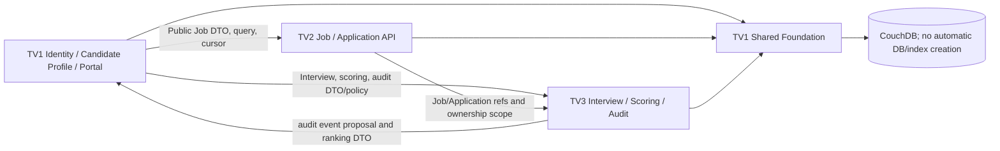

# RecruiHub — Technical Decision Register

**Version:** 1.0 (TV1 Stage 03D), 2026-10-23 (Asia/Saigon)  
**Project branch at review:** `feature/auth-profile-portal`  
**Authority:** TV1 decision record for its assigned scope. This document does not claim approval by TV2, TV3, or the group.

## 1. Purpose and authority

This register consolidates integration decisions for Shared Foundation, Authentication, Candidate Profile and Public Job Portal. It records what source implements, what DATA-02A already approves, what TV1 has endorsed for its own work, and what still requires cross-team acknowledgement. It does not change schemas, source, runtime routes, CouchDB, or business rules.

Use these labels precisely:

- **IMPLEMENTED** — verified in current source/tests; describes behavior, not a policy endorsement.
- **APPROVED_BY_DATA_CONTRACT** — explicitly specified by DATA-02A/business rules.
- **APPROVED_BY_TV1 — PENDING_TEAM_ACK** — TV1 adopts this direction for its work; TV2/TV3/group have not acknowledged it in the reviewed evidence.
- **PROPOSED** — recommendation for discussion; no owner approval recorded.
- **PENDING** — decision or required implementation detail remains open.

An approval is official across the team only when an acknowledgement is recorded in this register with approver, date, and scope. Silence, a prior proposal, or a passing test is not approval.

## 2. Ownership and approved boundaries

| Area | Owner | Current boundary |
|---|---|---|
| Shared CouchDB config/client/BaseRepository/common errors | TV1 | Implemented in backend foundation modules. |
| Identity, Authentication, Candidate Profile, Public Portal UI, Admin Users/Statistics | TV1 | Product assignment; auth/profile/admin business endpoints are not implemented by Foundation. |
| Job Management, Public Job API, Application | TV2 | TV2 owns domain behavior, repositories, DTOs, and API contract for these domains. |
| Interview, Scoring, Ranking, Audit | TV3 | TV3 owns domain behavior, repositories, DTOs, scoring and audit proposal. |
| Exactly nine business document types, discriminator `type` | DATA-02A | `user`, `candidate`, `recruiter`, `company`, `department`, `job`, `application`, `interview`, `resume_analysis`. No tenth type without an approved schema change. |

Shared Foundation does not create business `_id` or `type`, retry mutations, create database/index/view, or write to `recruitment_db` during Foundation tests. These boundaries are approved by the project contract/Stage 03 scope and match the implementation.

## 3. Decision register — DR-001 to DR-006

These six decisions are **APPROVED_BY_TV1 — PENDING_TEAM_ACK**. They are not group-approved until TV2/TV3 (where relevant) acknowledge them below.

| ID | TV1 decision | Status | Current implementation / compatibility note | Required acknowledgement |
|---|---|---|---|---|
| DR-001 API prefix | New business APIs use `/api/v1`. Keep operational `GET /api/health` and `GET /api/health/database` at their current paths; do not migrate them in this documentation task. | APPROVED_BY_TV1 — PENDING_TEAM_ACK | Only `/api/health` and `/api/health/database` are mounted. No domain `/api/v1` route has been implemented. This supersedes the earlier Stage 03C proposal to use `/api` for new MVP routes; no runtime change is made. | TV2/TV3 acknowledge versioned domain prefix and preserve ops health paths. |
| DR-002 Session direction | Use a JWT in an HttpOnly cookie and add CSRF protection for cookie-authenticated unsafe methods. | APPROVED_BY_TV1 — PENDING_TEAM_ACK; details PENDING | No authentication/cookie/CSRF code exists. Exact token lifetime, refresh, cookie flags and deployment topology remain open (DR-008/010/011/020). | Group security acknowledgement; record deployment assumptions. |
| DR-003 Registration boundary | Public self-registration creates Candidate only. Recruiter accounts are provisioned; no public Recruiter or Admin signup. | APPROVED_BY_TV1 — PENDING_TEAM_ACK; onboarding details PENDING | No registration route exists. Invite/approval/activation and recovery mechanics remain open (DR-019 and DR-012). | TV2 acknowledges Recruiter provisioning boundary; group confirms Candidate activation policy. |
| DR-004 Revision conflict | Business services follow DATA-02A: read fresh revision; recheck authorization, state transition and idempotency; retry at most once only if still valid; otherwise return controlled 409. | APPROVED_BY_TV1 — PENDING_TEAM_ACK | `CouchDbClient` does not retry and maps 409 to `CONFLICT`; service behavior does not yet exist. `AGENTS.md` says up to three automatic retries, so documentation is in conflict pending an authoritative reconciliation. This register does not edit either source. | Group/maintainer must resolve conflict with `AGENTS.md`; until then do not implement automatic retry. |
| DR-005 API envelope | Domain success: `{success:true,data:{...},message?}`. Domain error: `{success:false,error:{code,message,details:null}}`; details must be sanitized. | APPROVED_BY_TV1 — PENDING_TEAM_ACK; HTTP mapping PENDING | Helpers are provisional; readiness uses a related success shape. `errorResponse` currently defaults `details` to `[]`, and existing `/api/health` has a legacy body. No runtime route is changed; align source only after team contract approval. | TV2/TV3 acknowledge exact envelope and compatibility treatment for operational routes. |
| DR-006 Authorization | Enforce RBAC and ownership in backend services/middleware. Canonical roles: `CANDIDATE`, `RECRUITER`, `ADMIN`. Use only a server-verified principal; never trust role or owner IDs supplied by the client. | APPROVED_BY_TV1 — PENDING_TEAM_ACK; principal shape/scope PENDING | No auth middleware or `req.auth` exists. DATA-02A/business rules support the roles and ownership obligations. | Group acknowledges role/ownership boundary; define principal and Recruiter scope resolution. |

## 4. Decision register — DR-007 to DR-020

All entries below are **PENDING**. Values described as recommendations are options for review, not frozen implementation requirements.

| ID | Decision required | TV1 recommendation / evidence | Status and blocker |
|---|---|---|---|
| DR-007 | ADMIN bootstrap and recovery | One-time out-of-band provisioning, no default credential or public Admin signup; define recovery and last-admin protection. Dataset review reported no seeded ADMIN. | PENDING; blocks Admin API/UI acceptance. |
| DR-008 | JWT access/refresh lifetime and storage | Candidate option: 15-minute access and 7-day rotating refresh; decide session storage, revocation, reuse detection, key rotation and recovery before coding. | PENDING; blocks session lifecycle. |
| DR-009 | Password hashing | Candidate option: Argon2id, memory 65,536 KiB, time cost 3, parallelism 1, benchmark in target environment; use maintained library and never plain SHA-256. | PENDING; benchmark/library and parameter approval block credential writes. |
| DR-010 | CSRF mechanism | Candidate option: session-bound CSRF token plus Origin verification on unsafe methods. Decide issuance, validation, expiry, safe-method rules and exemptions. | PENDING; blocks cookie-authenticated mutation. |
| DR-011 | Cookie flags and deployment | Decide HttpOnly, Secure, SameSite, path/domain, local HTTP and cross-origin behavior. Candidate: HttpOnly; Secure on HTTPS; SameSite=Lax only for same-site deployment. | PENDING; deployment/topology dependent. |
| DR-012 | Seeded User claim/reset | Reviewed Stage 02.5 reported 10,150 seeded Users with no `password_hash`, all `RESET_REQUIRED`. Define verified claim/reset, one-time token, expiry and support flow; no shared/default password or bulk activation. Reconfirm count/state read-only before execution. | PENDING; blocks safe seeded-account activation. |
| DR-013 | Cursor pagination | Candidate: opaque cursor bound to normalized filters, sort and version; maximum page size 50; deterministic unique tie-breaker; validate Mango bookmark/query/index behavior. | PENDING; blocks cross-module list contract. |
| DR-014 | Index lifecycle | TV1 coordinates change process; TV2/TV3 submit measured query workloads; require review, owner, rollout/verification and rollback plan before index changes. | PENDING; ownership/process approval before index changes. No index creation in this stage. |
| DR-015 | Test isolation | Use fake clients for unit tests; live writes only against separately approved isolated DB; isolate legacy release/data tests in temporary workspace. | PENDING; required before any write integration/full legacy suite with shared paths. |
| DR-016 | Readiness endpoint exposure | `GET /api/health/database` is currently unauthenticated and returns DB name/count. Keep local/internal only; define network restriction/auth/metadata policy before deployment. | PENDING; blocks wider exposure. |
| DR-017 | Audit contract/storage | TV3 proposes event schema, storage, retention, redaction, access control and failure behavior. Do not add a CouchDB type absent approved schema migration. | PENDING; blocks audit persistence/viewer. |
| DR-018 | HTTP status mapping | Candidate domain mapping: 400 validation, 401 unauthenticated, 403 forbidden, 404 missing, 409 conflict, 429 rate limit, 500 internal, 502 upstream, 503 unavailable, 504 timeout. Agree per-code mapping and sanitized details. | PENDING; blocks shared API error conformance. Existing DB mapper is partial and not a complete domain contract. |
| DR-019 | Recruiter provisioning | Candidate: Admin invitation/provisioning plus explicit activation; define employer verification, invite expiry, resend/recovery and company/department ownership. No public Recruiter registration. | PENDING; blocks Recruiter onboarding. |
| DR-020 | Logout and refresh revocation | Candidate: clear auth cookie and revoke refresh session; define access-token residual lifetime and behavior when revocation storage is unavailable. | PENDING; blocks accurate logout/session semantics. |

## 5. Integration and dependency graph

| Dependency | Producer | Consumer | Required handoff |
|---|---|---|---|
| User principal, roles and Candidate profile | TV1 | TV2, TV3 | Canonical ID/role/status and safe profile DTO; verified principal contract. |
| Job public card/detail/list, filters and cursor | TV2 | TV1 | OPEN-only rules, field allowlist, query/sort/cursor, errors and examples. |
| Application lifecycle and summary/detail | TV2 | TV1, TV3 | Approved stages, ownership, DTO, conflict/idempotency and paging. |
| Interview lifecycle and DTO | TV3 | TV1, TV2 | Round/schedule/result behavior, ownership and errors. |
| Scoring/ranking DTO | TV3 | TV1, TV2 | Version, freshness, eligibility, fields and redaction. |
| Audit event/storage policy | TV3 proposes; group approves | TV1, TV2, TV3 | Schema/storage, retention, redaction, access, failure policy. |
| Foundation, CouchDB config/client/repository | TV1 | TV2, TV3 | Import existing implementation; do not duplicate. |
| API prefix/envelope/status/principal | Joint | All | Acknowledge DR-001/002/005/006 and resolve pending details. |

## 6. Approval checklist and decision history

Group members should reply with explicit status, scope and any amendment. Record names/roles and date only after receiving the acknowledgement; none is inferred here.

- [ ] TV2 acknowledges DR-001, DR-003 provisioning boundary, DR-004 conflict policy, DR-005 envelope and submits Job/Application API/DTO/query/cursor contracts.
- [ ] TV3 acknowledges DR-001, DR-004, DR-005 and submits Interview/Scoring/Ranking/Audit contracts and query workloads.
- [ ] Group resolves `AGENTS.md` three-retry wording versus DATA-02A one conditional retry (DR-004).
- [ ] Group decides DR-007 through DR-020 or assigns an owner/date for each.
- [ ] Record approver, role, date, decision ID, scope and contract version; update status without changing source behavior implicitly.

| Date | Decision/event | Authority/evidence | Effect |
|---|---|---|---|
| 2026-10-23 | TV1 recorded DR-001..006 as endorsed for TV1 scope, pending team acknowledgement; DR-007..020 as pending. | TV1 Stage 03D documentation task; no TV2/TV3 acknowledgement supplied. | Documentation only; no source/API/DB change. |

## 7. Change control and blockers

- Changes to the nine document types or DATA-02A semantics require a separately approved schema/business-rule change.
- Source implementation must follow a recorded decision and a scoped task; this register alone does not authorize route, cookie, auth, index or database changes.
- Update this register and the shared contract together; increment document version and record approver/date/evidence.
- **Stage 03 blockers:** session/CSRF details (DR-002, 008–011, 020), account onboarding/admin (DR-003, 007, 012, 019), shared API contract (DR-001, 005, 018), authorization principal (DR-006), conflict rule reconciliation (DR-004), and Public Job DTO/cursor (DR-013 plus TV2 handoff). Audit persistence (DR-017) blocks only audit-dependent work; readiness exposure (DR-016) blocks wider deployment; test isolation (DR-015) blocks live-write testing.

## 8. Proposed group approval agenda

1. Acknowledge DR-001..006 as team policy or return amendments; explicitly resolve the AGENTS.md/DATA-02A conflict.
2. Decide session and password controls DR-008..011/020 and account activation/bootstrap DR-007/012/019.
3. Freeze status/error and cursor contracts DR-013/018 with TV2/TV3 query evidence.
4. Agree index governance, readiness exposure, audit storage and test isolation DR-014..017.
5. Record approvers, date, contract version and implementation owners. Keep every unanswered item marked PENDING.